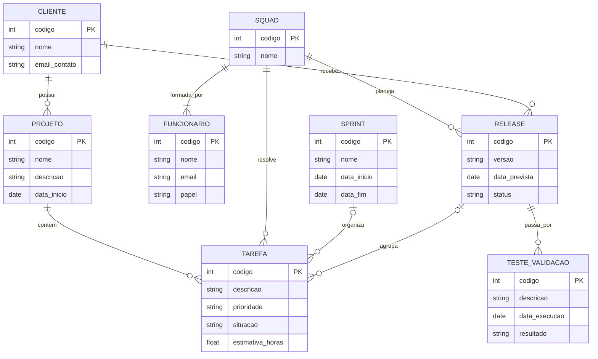

# Tarefa 02 - MER e Projeto de Banco de Dados Relacional

**Aluno:** `PHS-00`/`Pedro Henrique da Silva`

## Q1. Elementos Básicos do Modelo Entidade-Relacionamento (MER)

O Modelo Entidade-Relacionamento (MER) representa a estrutura lógica conceitual de um banco de dados por meio de três elementos fundamentais:

1. **Entidades:** Representam objetos, pessoas, locais ou conceitos do mundo real com existência independente (física ou abstrata) sobre os quais se deseja armazenar informações (ex.: `Cliente`, `Funcionario`, `Tarefa`). Dividem-se em *entidades fortes* (possuem identificador próprio) e *entidades fracas* (dependem de uma entidade proprietária para existir e ser identificada).
2. **Atributos:** São as propriedades ou características que descrevem uma entidade ou um relacionamento (ex.: `codigo`, `nome`, `email`). Podem ser classificados como simples ou compostos, monovalorados ou multivalorados, armazenados ou derivados, além dos **atributos identificadores (chave)**, que distinguem unicamente cada instância da entidade.
3. **Relacionamentos:** Representam as associações semânticas entre duas ou mais entidades (ex.: uma `Squad` *resolve* uma `Tarefa`). Possuem grau (unário, binário, ternário) e restrições estruturais definidas pela **cardinalidade** (`1:1`, `1:N`, `N:M`) e pela **participação** (total/obrigatória ou parcial/opcional).

## Q2. Notações para Diagramas ER

Existem diversas notações gráficas para representar os mesmos conceitos conceituais em Diagramas Entidade-Relacionamento:

* **Notação de Peter Chen (1976):** Notação acadêmica clássica em que entidades são retângulos, atributos são elipses (com o atributo identificador sublinhado) e relacionamentos são losangos ligados às entidades por linhas.
* **Notação Pé de Galinha (*Crow's Foot* / Information Engineering):** Amplamente utilizada em ferramentas CASE e no Mermaid.js. As entidades são caixas retangulares que contêm os atributos internamente, e os relacionamentos são linhas diretas sem losangos.
* **Notação UML (Diagrama de Classes adaptado):** Representa entidades como classes (retângulos compartimentados) e relacionamentos como associações com multiplicidades nas extremidades.
* **Notação IDEF1X:** Muito empregada na engenharia de software corporativa, diferencia visualmente relacionamentos identificadores (linhas contínuas) de não identificadores (linhas tracejadas).

### Exemplos comparativos para o mesmo conceito

* **Cardinalidade (Um para Muitos):**
  * *Chen:* Escreve-se `1` junto a uma extremidade do losango e `N` na outra (ou pares mínimo/máximo como `(1,1)` e `(0,N)`).
  * *Pé de Galinha (Crow's Foot / Mermaid):* Utiliza símbolos nas pontas da linha, como `||--o{` (exatamente um de um lado e zero ou muitos do outro).
  * *UML:* Indica a multiplicidade numericamente nas pontas da associação (`1` de um lado e `0..*` do outro).
* **Entidade Fraca / Subordinada:**
  * *Chen:* Representada por um retângulo de borda dupla associado a um losango também de borda dupla.
  * *IDEF1X / Pé de Galinha:* Representada por um retângulo de cantos arredondados ligado por uma linha contínua (relacionamento identificador) à entidade proprietária.
* **Atributo Identificador (Chave):**
  * *Chen:* Elipse separada com o texto sublinhado.
  * *Pé de Galinha / Mermaid:* Listado dentro do bloco da entidade com o marcador `PK`.

## Q3. Diagrama ER Conceitual (Mermaid.js)

O diagrama abaixo representa o modelo conceitual da empresa de desenvolvimento de software sem redundância de dados e sem chaves estrangeiras:

## Q4. Mapeamento para o Modelo Relacional

Aplicando as regras de transformação do MER para o Modelo Relacional (propagando as chaves primárias do lado `1` como chaves estrangeiras no lado `N`):

1. **CLIENTE** (`codigo`, `nome`, `email_contato`)
   * **Chave Primária (PK):** `codigo`
   * **Chaves Estrangeiras (FK):** Nenhuma.

2. **PROJETO** (`codigo`, `nome`, `descricao`, `data_inicio`, `codigo_cliente`)
   * **Chave Primária (PK):** `codigo`
   * **Chave Estrangeira (FK):** `codigo_cliente` referencia `CLIENTE(codigo)`

3. **SQUAD** (`codigo`, `nome`)
   * **Chave Primária (PK):** `codigo`
   * **Chaves Estrangeiras (FK):** Nenhuma.

4. **FUNCIONARIO** (`codigo`, `nome`, `email`, `papel`, `codigo_squad`)
   * **Chave Primária (PK):** `codigo`
   * **Chave Estrangeira (FK):** `codigo_squad` referencia `SQUAD(codigo)`

5. **SPRINT** (`codigo`, `nome`, `data_inicio`, `data_fim`)
   * **Chave Primária (PK):** `codigo`
   * **Chaves Estrangeiras (FK):** Nenhuma.

6. **RELEASE** (`codigo`, `versao`, `data_prevista`, `status`, `codigo_squad`, `codigo_cliente`)
   * **Chave Primária (PK):** `codigo`
   * **Chaves Estrangeiras (FK):**
     * `codigo_squad` referencia `SQUAD(codigo)`
     * `codigo_cliente` referencia `CLIENTE(codigo)`

7. **TAREFA** (`codigo`, `descricao`, `prioridade`, `situacao`, `estimativa_horas`, `codigo_projeto`, `codigo_squad`, `codigo_sprint`, `codigo_release`)
   * **Chave Primária (PK):** `codigo`
   * **Chaves Estrangeiras (FK):**
     * `codigo_projeto` referencia `PROJETO(codigo)`
     * `codigo_squad` referencia `SQUAD(codigo)`
     * `codigo_sprint` referencia `SPRINT(codigo)` *(permite `NULL` enquanto a tarefa está no backlog)*
     * `codigo_release` referencia `RELEASE(codigo)` *(permite `NULL` antes de ser agrupada em uma release)*

8. **TESTE_VALIDACAO** (`codigo`, `descricao`, `data_execucao`, `resultado`, `codigo_release`)
   * **Chave Primária (PK):** `codigo`
   * **Chave Estrangeira (FK):** `codigo_release` referencia `RELEASE(codigo)`

