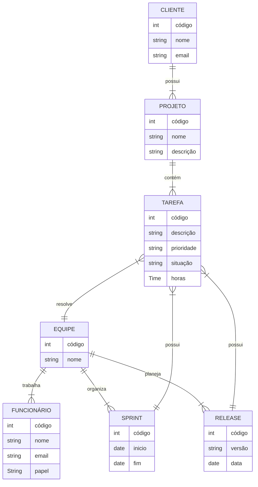
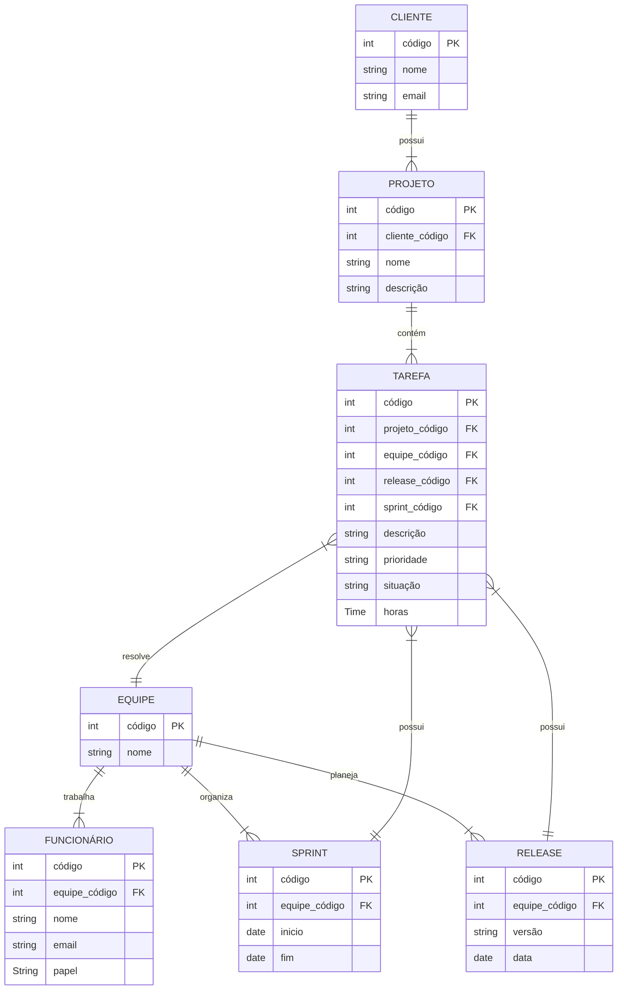

**Tarefa 02 \- MER e Projeto de Banco de Dados Relacional**

**Q1.** O modelo de dados entidade-relacionamento foi desenvolvido para facilitar o projeto de banco de dados, permitindo especificação de um esquema que representa a estrutura lógica geral de um banco de dados. Descreva os três elementos básicos de um Modelo Entidade Relacionamento (MER).

O Modelo Entidade-Relacionamento é composto por três elementos básicos: entidades, atributos e relacionamentos. A entidade representa um objeto ou conceito do mundo real sobre o qual se deseja guardar informações e que pode ser distinguido dos demais, como um cliente, um funcionário ou um projeto.
Os atributos são as propriedades que descrevem uma entidade ou um relacionamento, como o nome e o e-mail de um cliente. Entre eles, o atributo identificador (ou chave) é aquele que o valor diferencia cada ocorrência da entidade, como o código do cliente. Os atributos também podem ser simples ou compostos, e obrigatórios ou opcionais.
O relacionamento representa a associação entre duas ou mais entidades, como “o cliente contrata um projeto”. Ele é caracterizado pela cardinalidade, que define quantas ocorrências de uma entidade podem se associar a quantas ocorrências da outra (um para um, um para muitos ou muitos para muitos), e pela participação, que indica se a associação é obrigatória ou opcional.

**Q2.** Pesquise sobre as várias notações possíveis para Diagramas ER e cite alguns exemplos de notações diferentes para o mesmo conceito (ex.: cardinalidade, entidade subordinada, etc.).

A notação de Peter Chen, representa entidades como retângulos, relacionamentos como losangos e atributos como elipses, e indica a cardinalidade com números (1, N ou M) escritos nas linhas que ligam o relacionamento às entidades. A notação pé de galinha (crow’s foot, ou engenharia de informação) representa as entidades como retângulos com os atributos listados dentro delas, e os relacionamentos como linhas simples, cuja cardinalidade é indicada pelos símbolos nas pontas: um traço para “um”, um círculo para “zero” e um símbolo de três pontas, semelhante a um pé de galinha, para “muitos”. É a notação usada pelo Mermaid.
Outra opção é a notação UML (diagrama de classes), que usa o formato mínimo..máximo (como 0..1, 1..* ou 0..*) nas extremidades das associações. Já a notação IDEF1X representa as entidades dependentes com cantos arredondados e as independentes com cantos retos, além de diferenciar relacionamentos identificadores (linha contínua) e não identificadores (linha tracejada).
Um mesmo conceito aparece de formas diferentes em cada notação. Para a cardinalidade “um cliente possui muitos projetos”, Chen escreve 1 de um lado e N do outro, o pé de galinha desenha o símbolo de três pontas junto a projeto, e a UML escreve 1 de um lado e 0..* do outro. Para a entidade subordinada (fraca), que depende de outra para existir, Chen usa um retângulo de linha dupla ligado por um losango duplo, enquanto o IDEF1X usa o retângulo de cantos arredondados.

**Q3.** Construa um Diagrama ER para projetar a base de dados de uma **empresa de desenvolvimento de software** com outras empresas como clientes. A base de dados não deve conter redundância de dados. O modelo ER deve ser representado com um diagrama usando **Mermaid.js**. O modelo deve apresentar, ao menos, entidades, relacionamentos, atributos, identificadores e restrições de cardinalidade. O modelo deve ser feito no nível conceitual, **sem incluir chaves estrangeiras**.
a) A empresa presta serviços de desenvolvimento de software para outras empresas (clientes). Cada cliente é identificado por um código, um nome e um e-mail de contato.
b) Os funcionários da empresa trabalham em squads (equipes). Cada funcionário é identificado por um código, um nome e um e-mail, e possui um papel na equipe: desenvolvedor, testador, líder técnico, supervisor ou gerente de produto.
c) Cada squad é formada por vários funcionários e resolve tarefas (issues). Uma tarefa tem código, descrição, prioridade, situação e uma estimativa em horas. As tarefas pertencem a projetos de um cliente.
d) O trabalho é organizado em iterações (sprints). Uma squad planeja releases para seus clientes; uma release agrupa um conjunto de tarefas e passa por testes de validação.

**Q4.** A partir do Diagrama ER da questão anterior, faça o mapeamento para o Modelo Relacional: liste as relações (tabelas), com seus atributos, e identifique as chaves primárias e as chaves estrangeiras de cada relação.

