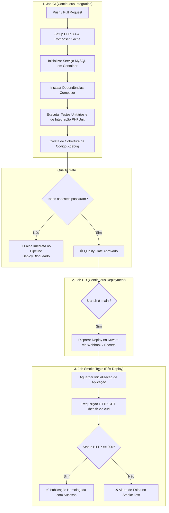
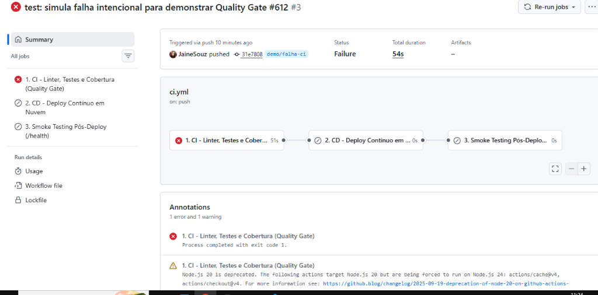

# Tarefa 04 - DevOps, Integração e Entrega Contínua (CI/CD) com Testes Automatizados

## Identificação

- **Nome:** Jaine Souza da Luz
- **GitHub:** [JaineSouz](https://github.com/JaineSouz)
- **E-mail:** [jainesouza1520@gmail.com](mailto:jainesouza1520@gmail.com)

## Links de Entrega

- **Issue da Disciplina:** [#612 — Tarefa 04 - DevOps, Integração e Entrega Contínua (CI/CD) Jaine Souza da Luz](https://github.com/tacianosilva/bsi-tasks/issues/612)
- **Pull Request no Repositório da Disciplina (`bsi-tasks`):** *[Link a ser preenchido após abertura do PR]*
- **Repositório Individual da Aplicação:** [https://github.com/JaineSouz/projetoPNLD](https://github.com/JaineSouz/projetoPNLD)
- **Pull Request no Repositório Individual:** [https://github.com/JaineSouz/projetoPNLD/pull/1](https://github.com/JaineSouz/projetoPNLD/pull/1)
- **URL Pública da Aplicação (Deploy em Nuvem):** [https://projeto-pnld-jaine.onrender.com/](https://projeto-pnld-jaine.onrender.com/)
- **Endpoint de Integridade (/health):** [https://projeto-pnld-jaine.onrender.com/health](https://projeto-pnld-jaine.onrender.com/health)

---

## 1. Pesquisa e Fundamentação Teórica

### 1.1 Cultura DevOps e Testes Contínuos (*Continuous Testing*)

#### O que é a cultura DevOps e a superação do "Muro da Confusão"
A cultura **DevOps** representa a união de filosofias culturais, práticas e ferramentas que visam integrar as equipes de **Desenvolvimento de Software (*Dev*)** e **Operações/Infraestrutura (*Ops*)**. 

Historicamente, o modelo tradicional de desenvolvimento gerava o chamado **"muro da confusão" (*wall of confusion*)**, originado por incentivos conflitantes entre as áreas:
- A equipe de **Desenvolvimento** era avaliada pela velocidade e volume de entrega de novas funcionalidades, pressionando por mudanças rápidas no sistema.
- A equipe de **Operações** era avaliada pela disponibilidade, confiabilidade e estabilidade do ambiente em produção, encarando qualquer nova alteração como um risco em potencial de indisponibilidade (*downtime*).

Ao concluir uma funcionalidade, os desenvolvedores literalmente "jogavam o código por cima do muro" para que a equipe de operações fizesse o deploy. Quando falhas ocorriam em produção, iniciava-se um jogo de empurra de responsabilidades (*"na minha máquina funciona, o problema é no servidor"* versus *"o ambiente está perfeito, o código de vocês veio com defeito"*).

O DevOps supera esse conflito ao estabelecer **responsabilidade compartilhada de ponta a ponta** (*"You build it, you run it"* — se você constrói, você opera). Ambas as equipes passam a colaborar continuamente em todo o ciclo de vida da aplicação — desde o planejamento e codificação até a implantação e monitoramento —, apoiando-se nos quatro pilares do modelo **CAMS**:
1. **Cultura (*Culture*):** Colaboração, comunicação transparente e ausência de culpabilização individual (*blameless culture*).
2. **Automação (*Automation*):** Eliminação de tarefas manuais repetitivas por meio de esteiras de CI/CD e infraestrutura como código (IaC).
3. **Métricas (*Measurement*):** Acompanhamento contínuo de indicadores de entrega e confiabilidade (tais como as métricas DORA: frequência de deploy, tempo de entrega de mudanças, taxa de falha de mudanças e tempo médio de recuperação).
4. **Compartilhamento (*Sharing*):** Disseminação aberta de conhecimento, ferramentas e lições aprendidas entre todos os envolvidos.

#### Transformação do Teste de Software no paradigma DevOps e a evolução do papel do QA
No modelo tradicional em cascata (*Waterfall*), o teste de software ocorria como uma **etapa tardia e isolada**, realizada após a conclusão integral da fase de desenvolvimento. Os analistas de testes recebiam uma versão acabada e realizavam exaustivos ciclos manuais de verificação. Esse formato apresentava gargalos críticos: os defeitos eram descobertos muito tarde (quando a correção é complexa e financeiramente dispendiosa), a comunicação era morosa e os prazos de lançamento acabavam sendo atrasados.

No paradigma DevOps, o teste de software se transforma em **Continuous Testing (Testes Contínuos)**. O ato de testar deixa de ser uma fase isolada e torna-se uma atividade ininterrupta executada ao longo de todas as etapas do ciclo de vida:
- Os testes são amplamente automatizados e incorporados ao pipeline de integração contínua (executados a cada commit ou Pull Request).
- O objetivo central deixa de ser meramente "encontrar bugs antes do cliente" e passa a ser **fornecer feedback imediato sobre o risco de negócio** de cada alteração de código.

Com essa mudança, o papel do **Analista de Qualidade (QA)** sofre uma profunda evolução:
- **De testador manual para Engenheiro de Qualidade / Facilitador (*Quality Coach*):** O QA deixa de ser um "inspetor de final de linha" responsável por validar telas manualmente e passa a ser um arquiteto e facilitador de qualidade.
- **Atuação colaborativa e estratégica:** O QA orienta a equipe de desenvolvimento na escrita de testes eficazes, define as estratégias e métricas de qualidade, constrói e mantém os frameworks de automação do pipeline e colabora diretamente na definição de critérios de aceitação e testes não-funcionais (performance, segurança e resiliência).

#### Shift-Left Testing versus Shift-Right Testing

```mermaid
flowchart LR
    subgraph ShiftLeft["👈 SHIFT-LEFT (Prevenção)"]
        direction TB
        A1["Análise de Requisitos & BDD"]
        A2["Análise Estática de Código & Linters"]
        A3["Testes de Unidade (TDD / Mocks)"]
        A4["Testes de Integração Rápidos"]
    end

    subgraph Pipeline["ESTEIRA CI/CD (Quality Gate)"]
        direction TB
        B1["Build & Testes"]
        B2["Validação de Cobertura"]
        B3["Deploy Automatizado"]
    end

    subgraph ShiftRight["👉 SHIFT-RIGHT (Observabilidade)"]
        direction TB
        C1["Smoke Tests Pós-Deploy"]
        C2["Testes Sintéticos Contínuos"]
        C3["Deploy Canário / Feature Flags"]
        C4["Monitoramento & Telemetria (Logs/Métricas)"]
    end

    ShiftLeft --> Pipeline --> ShiftRight
```



- **Shift-Left Testing (Mover para a Esquerda):**
  - **Conceito:** Significa antecipar as atividades de teste e garantia de qualidade para as fases mais iniciais do ciclo de vida do desenvolvimento de software (à esquerda na linha do tempo do projeto).
  - **Práticas:** Envolvimento do time de testes na análise de requisitos (BDD), uso de linters e analisadores estáticos no editor do desenvolvedor, adoção de desenvolvimento guiado por testes (TDD), escrita de testes unitários com mocks e execução imediata da suíte de testes a cada commit local ou abertura de Pull Request.
  - **Benefício:** Identificação precoce de defeitos e vulnerabilidades arquiteturais. Segundo a regra de Myers/Pressman, um defeito detectado e corrigido na fase de codificação/unidade custa até 100 vezes menos do que o mesmo defeito descoberto em produção.

- **Shift-Right Testing (Mover para a Direita):**
  - **Conceito:** Significa estender as práticas de teste e garantia da qualidade para além do deploy, avaliando o comportamento do software diretamente em ambiente de produção ou pré-produção sob condições reais de uso (à direita na linha do tempo).
  - **Práticas:** Execução de testes de fumaça (*Smoke Tests*) imediatamente após a publicação para confirmar a disponibilidade básica dos endpoints; monitoramento de telemetria e APM (Application Performance Monitoring); testes com usuários reais via *Feature Flags* e *Canary Deployments*; testes de injeção de falhas (*Chaos Engineering*); e análise contínua de logs e métricas de negócio.
  - **Benefício:** Permite validar requisitos de confiabilidade, estabilidade, latência e usabilidade que não podem ser reproduzidos com total fidelidade em ambientes de teste controlados.

---

### 1.2 Conceituação de CI, CD e CD

| Conceito | Sigla | Definição | Nível de Automação | Ação de Deploy em Produção |
|---|:---:|---|---|:---:|
| **Integração Contínua** | **CI** | Prática em que desenvolvedores integram seu código com frequência (idealmente várias vezes ao dia) a uma branch compartilhada. A cada alteração, uma esteira automatizada executa o build, linters e testes para validar a integridade da aplicação. | Build + Testes automatizados a cada push ou PR | Nenhuma (o foco é a validação do código) |
| **Entrega Contínua** | **CD** | Extensão da Integração Contínua onde, além de testado, o software é automaticamente empacotado (artefatos, containers) e implantado em ambientes de teste/homologação (*staging*). O sistema é mantido **sempre em estado pronto para ser publicado em produção**. | Build + Testes + Empacotamento + Deploy em Staging automatizados | **Manual** (depende de decisão de negócio ou clique de um botão pelo responsável) |
| **Implantação Contínua** | **CD** | Estágio avançado e totalmente automatizado da esteira, onde qualquer alteração que passe com sucesso por todos os testes e portões de qualidade é **automaticamente publicada diretamente em produção**, sem qualquer intervenção humana. | Ciclo completo 100% automatizado (do commit à produção) | **Automática** (acionada imediatamente após a aprovação de todos os testes no pipeline) |

---

### 1.3 O Papel dos Testes de Software na Esteira de CI/CD

#### O Conceito de *Quality Gate* (Portão de Qualidade)
Um **Quality Gate** é um conjunto de condições e critérios objetivos que um artefato de software deve satisfazer obrigatoriamente antes de receber autorização para avançar para o próximo estágio do pipeline ou ser publicado em produção. Exemplos de critérios comuns incluem:
- 100% de aprovação na suíte de testes automatizados (zero falhas e zero erros);
- Atingimento de um percentual mínimo estipulado de cobertura de código (ex.: $\ge 80\%$);
- Zero vulnerabilidades críticas ou altas em análises estáticas de segurança (SAST) e dependências (SCA);
- Ausência de violações graves de padrões de formatação e análise estática (*linters*).

> **Por que uma esteira automatizada sem testes não é uma esteira de entrega contínua segura?**  
> Sem testes automatizados atuando como *Quality Gate*, a automação se resume a um mecanismo de transporte que apenas acelera a entrega de código, sem qualquer garantia sobre seu correto funcionamento. Uma esteira rápida sem testes atua, na verdade, como um **amplificador e propagador veloz de incidentes**, levando código quebrado, falhas de segurança e regressões de funcionalidades para o ambiente de produção em minutos, aumentando o risco de indisponibilidade e prejuízos ao negócio.

#### A Pirâmide de Testes e a Otimização Temporal no Pipeline (*Fail-Fast*)
A pirâmide de testes, proposta por Mike Cohn e popularizada por Martin Fowler, organiza os testes de software em camadas conforme o nível de granularidade, tempo de execução e custo:

```
        / \
       /   \        Testes de Sistema / E2E (Topo)
      / E2E \       - Mais lentos, caros e frágeis; menor quantidade.
     /-------\
    /  Integ  \     Testes de Integração (Meio)
   /-----------\    - Verificam interação com banco de dados e serviços; velocidade moderada.
  /   Unidade   \   Testes de Unidade (Base)
 /---------------\  - Extremamente rápidos, isolados via mocks; altíssima quantidade.
```

Para garantir o princípio do **Fail-Fast** (falhar o mais rápido possível e fornecer feedback imediato ao desenvolvedor), a esteira de CI deve organizar a execução das etapas em ordem estrita de velocidade:
1. **Estágio 1 — Linters e Checagens Sintáticas:** Executam em poucos segundos, rejeitando imediatamente código fora de padrão.
2. **Estágio 2 — Testes de Unidade:** Utilizam *mocks* e executam em milissegundos a poucos segundos. Se houver qualquer falha de lógica básica, o pipeline é interrompido imediatamente (*Quality Gate*), economizando tempo de execução e recursos de infraestrutura.
3. **Estágio 3 — Testes de Integração:** Requerem inicialização de contêineres de suporte (como instâncias do MySQL) e transações no banco, levando um tempo intermediário.
4. **Estágio 4 — Testes End-to-End / Sistema:** São os mais lentos e custosos; devem ser executados apenas após a aprovação total das camadas anteriores.

---

### 1.4 Estratégias de Deploy e Segurança de Segredos

#### Estratégias de Publicação (Deploy)
1. **Recreate (Recriação):**
   - **Como funciona:** A versão anterior da aplicação é totalmente desativada antes do início da implantação da nova versão.
   - **Vantagens:** Simplicidade de configuração e garantia de que nunca haverá instâncias de versões distintas compartilhando recursos ou o mesmo banco de dados simultaneamente.
   - **Desvantagens:** Provoca indisponibilidade (*downtime*) perceptível aos usuários durante o intervalo de desligamento e inicialização.
2. **Rolling Update (Atualização Gradual):**
   - **Como funciona:** As instâncias existentes são substituídas pela nova versão progressivamente, uma a uma ou em lotes. Um balanceador de carga encaminha o tráfego apenas para as instâncias ativas e saudáveis.
   - **Vantagens:** Zero indisponibilidade (*zero-downtime*) e atualização gradual sem demandar a duplicação completa dos recursos de infraestrutura.
   - **Desvantagens:** Durante o período de transição, instâncias da versão antiga e da nova versão coexistem ativas, exigindo compatibilidade retroativa de APIs e esquemas de banco de dados.
3. **Blue/Green Deployment:**
   - **Como funciona:** Mantêm-se dois ambientes de produção idênticos, denominados *Blue* (ambiente ativo recebendo o tráfego dos usuários) e *Green* (ambiente inativo). A nova versão é instalada e testada no ambiente *Green*. Quando a validação é concluída com sucesso, o roteador/balanceador de carga chaveia todo o tráfego instantaneamente para o ambiente *Green*.
   - **Vantagens:** Zero indisponibilidade e processo de reversão (*rollback*) praticamente instantâneo caso ocorra algum imprevisto (bastando reverter o direcionamento do roteador de volta para o ambiente *Blue*).
   - **Desvantagens:** Requer o dobro de recursos de infraestrutura para manter os dois ambientes espelhados simultaneamente.

#### Gerenciamento Seguro de Variáveis e Credenciais (*Secrets Management*)
Em esteiras de CI/CD, o pipeline precisa acessar dados de alta criticidade, como senhas de banco de dados, chaves de API de provedores em nuvem, tokens de autenticação do GitHub e certificados de acesso.

A utilização de ferramentas dedicadas de gestão de segredos (como o **GitHub Actions Secrets**, AWS Secrets Manager ou HashiCorp Vault) é indispensável por motivos capitais:
- **Prevenção de Vazamento no Controle de Versão:** Evita que credenciais sejam salvas em texto puro dentro do repositório (*hardcoded secrets*), o que permitiria acesso indevido por qualquer membro ou invasores (no caso de repositórios públicos).
- **Mascaramento Automático em Logs:** O GitHub Actions oculta automaticamente os valores de variáveis registradas como secrets nos logs de execução do console, substituindo-os por `***` para evitar captura acidental.
- **Controle de Acesso e Rotação:** Permite alterar credenciais expiradas ou rotacionar chaves de infraestrutura em um único local centralizado, sem necessidade de modificar código ou recompilar imagens da aplicação.

---

## 2. Arquitetura da Aplicação e Configuração Docker

A aplicação adotada para a realização da tarefa consiste no módulo CRUD de Alunos desenvolvido no projeto **PNLD (Sistema HBL)** na stack **PHP 8.4** com **PHPUnit** e banco de dados **MySQL**.

### 2.1 Endpoint de Integridade (`/health`)

Foi implementado o endpoint de monitoramento de integridade em `health.php`, com suporte a roteamento para responder diretamente em `/health`. O endpoint retorna status HTTP `200 OK` e um payload em JSON informando o estado operacional da aplicação:

```json
{
  "status": "UP",
  "timestamp": "2026-11-21T18:45:00+00:00",
  "service": "Sistema HBL - PNLD",
  "environment": "production",
  "php_version": "8.4.1"
}
```

### 2.2 Containerização com Dockerfile

A aplicação é empacotada por meio do `Dockerfile`, que provisiona o ambiente PHP, instala extensões essenciais (`mysqli`, `zip`, `curl`) e expõe o serviço na porta configurável pelo ambiente:

```dockerfile
FROM php:8.4-cli

RUN apt-get update \
    && apt-get install -y unzip libzip-dev libcurl4-openssl-dev \
    && docker-php-ext-install mysqli zip curl \
    && rm -rf /var/lib/apt/lists/*

COPY --from=composer:2 /usr/bin/composer /usr/bin/composer

WORKDIR /app
COPY . .

EXPOSE 8000
CMD ["sh", "-c", "php -S 0.0.0.0:${PORT:-8000} -t /app /app/router.php"]
```

---

## 3. Pipeline de CI/CD no GitHub Actions

O workflow foi estruturado no arquivo `.github/workflows/ci-cd.yml`, contemplando os estágios de **CI (Integração Contínua)**, **CD (Implantação Contínua)** e **Smoke Testing (Verificação Pós-Deploy)**.



### 3.1 Especificação do Workflow (`ci-cd.yml`)

```yaml
name: CI/CD Pipeline & Quality Gate

on:
  push:
    branches: [ main ]
  pull_request:
    branches: [ main ]

jobs:
  ci:
    name: Continuous Integration & Quality Gate
    runs-on: ubuntu-latest

    services:
      mysql:
        image: mysql:8.4
        env:
          MYSQL_ROOT_PASSWORD: rootpassword
          MYSQL_DATABASE: SistemaHBL
          MYSQL_USER: pnld
          MYSQL_PASSWORD: pnldpassword
        ports:
          - 3306:3306
        options: >-
          --health-cmd="mysqladmin ping -h 127.0.0.1 --silent"
          --health-interval=5s
          --health-timeout=5s
          --health-retries=30

    steps:
      - name: Baixar Código
        uses: actions/checkout@v4

      - name: Configurar PHP 8.4 com Extensões e Xdebug
        uses: shivammathur/setup-php@v2
        with:
          php-version: '8.4'
          extensions: mysqli, pdo_mysql, mbstring, dom, xml, xmlwriter
          coverage: xdebug
          tools: composer:v2

      - name: Cache de Dependências do Composer
        uses: actions/cache@v4
        with:
          path: vendor
          key: ${{ runner.os }}-composer-${{ hashFiles('**/composer.lock') }}
          restore-keys: ${{ runner.os }}-composer-

      - name: Instalar Dependências
        run: composer install --no-interaction --prefer-dist

      - name: Inicializar Esquema do Banco de Dados
        run: |
          sudo apt-get update && sudo apt-get install -y mysql-client
          mysql -h 127.0.0.1 -u pnld -ppnldpassword SistemaHBL < sql/bancoPNLD.sql

      - name: Executar Testes Automatizados e Cobertura (Quality Gate)
        env:
          XDEBUG_MODE: coverage
          DB_HOST: 127.0.0.1
          DB_USER: pnld
          DB_PASSWORD: pnldpassword
          DB_NAME: SistemaHBL
        run: |
          vendor/bin/phpunit --configuration phpunit.xml --coverage-text --coverage-clover coverage.xml

      - name: Salvar Artefato de Cobertura
        uses: actions/upload-artifact@v4
        with:
          name: relatorio-cobertura
          path: coverage.xml
          if-no-files-found: error

  cd:
    name: Continuous Deployment
    needs: ci
    if: github.ref == 'refs/heads/main' && github.event_name == 'push'
    runs-on: ubuntu-latest

    steps:
      - name: Disparar Deploy em Nuvem (Render Deploy Hook)
        env:
          RENDER_DEPLOY_HOOK: ${{ secrets.RENDER_DEPLOY_HOOK }}
        run: |
          echo "Disparando deploy automatizado via Webhook seguro..."
          curl -f -X POST "$RENDER_DEPLOY_HOOK"

  smoke-tests:
    name: Smoke Testing Pós-Deploy
    needs: cd
    runs-on: ubuntu-latest

    steps:
      - name: Verificar Integridade do Endpoint /health
        run: |
          echo "Aguardando estabilização do deploy..."
          sleep 25
          URL="${{ secrets.APP_BASE_URL }}/health"
          echo "Executando Smoke Test em: $URL"
          STATUS=$(curl -s -o /dev/null -w "%{http_code}" "$URL" || true)
          echo "Código HTTP recebido: $STATUS"
          if [ "$STATUS" -eq 200 ]; then
            echo "Smoke test aprovado: Aplicação operacional e respondendo HTTP 200!"
            exit 0
          else
            echo "Erro: Aplicação respondeu com código inesperado: $STATUS"
            exit 1
          fi
```

---

## 4. Simulação Prática do Quality Gate Bloqueando o Deploy

Para demonstrar a eficácia do Quality Gate na proteção do ambiente de produção, foi executada a simulação controlada de quebra de teste:

### 4.1 Cenário de Falha Introduzido
1. Foi criada a branch temporária `demo/falha-ci` a partir da branch da tarefa.
2. No arquivo de testes unitários `tests/HealthCheckTest.php`, foi alterada propositalmente uma asserção para forçar um resultado incorreto (esperando `status == 'DOWN'`, enquanto a aplicação retorna `'UP'`).
3. Foi enviado o commit `31e7808` (`test: simula falha intencional para demonstrar Quality Gate #612`) para o GitHub, acionando a esteira automaticamente.

### 4.2 Evidência do Quality Gate Bloqueando o Pipeline
O estágio de **CI** detectou a falha do teste imediatamente:
- O PHPUnit retornou código de erro na asserção (`Process completed with exit code 1`).
- O estágio **1. CI - Linter, Testes e Cobertura (Quality Gate)** foi marcado com status de falha (Failure - ❌).
- Os estágios dependentes de publicação: **2. CD - Deploy Contínuo em Nuvem** e **3. Smoke Testing Pós-Deploy (/health)** foram **bloqueados / impedidos de executar** (duração 0s e status cancelado), comprovando na prática que qualquer alteração com teste quebrado é sumariamente barrada pelo Quality Gate antes de atingir o ambiente de produção.



### 4.3 Restabelecimento do Pipeline
A asserção foi corrigida no commit `d8e71c9` (`fix: corrige teste para restabelecer esteira verde #612`), restaurando a expectativa para `'UP'`. A esteira de CI foi executada novamente na branch `demo/falha-ci`, restabelecendo o status 100% verde (aprovado) e liberando o fluxo contínuo.

---

## 5. Conclusão

A implementação demonstrou na prática a integração entre a teoria da cultura DevOps e a automação de processos de entrega de software. A configuração da esteira automatizada no GitHub Actions, associada ao Docker e a endpoints de monitoramento de integridade (*Smoke Testing*), garante que a qualidade seja aferida continuamente desde a escrita do código (*Shift-Left*) até a validação em tempo de execução (*Shift-Right*), consolidando a suíte de testes como um *Quality Gate* indispensável para a estabilidade e confiabilidade do produto.
