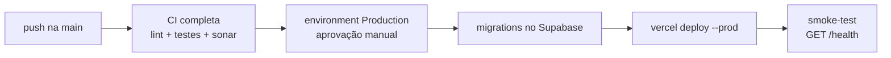

# Tarefa 04 - DevOps, Integração e Entrega Contínua (CI/CD) com Testes Automatizados

## Identificação

| Campo            | Valor                                                                     |
| :--------------- | :------------------------------------------------------------------------ |
| Nome completo    | José Samuel Silva Lima                                                    |
| Usuário GitHub   | [@Jose-Samuel-Lima](https://github.com/Jose-Samuel-Lima)                  |
| E-mail           | jose.lima.146@ufrn.edu.br                                                  |
| Issue            | [#607](https://github.com/tacianosilva/bsi-tasks/issues/607)              |
| Turma / Grupo    | Teste de Software 2026.2 — G4 (SpendSmart)                                 |
| Branch de entrega | `task/607-ci-cd`                                                          |

---

## Links de Entrega

| Entrega                                                        | Link                                                                                                                     |
| :------------------------------------------------------------- | :----------------------------------------------------------------------------------------------------------------------- |
| Repositório do projeto com o workflow de CI/CD configurado      | [MViniciusCoffe/SpendSmart](https://github.com/MViniciusCoffe/SpendSmart)                                                |
| Pull Request que introduziu o CI/CD no repositório do projeto   | [SpendSmart #104](https://github.com/MViniciusCoffe/SpendSmart/pull/104) (mergeado)                                      |
| Aplicação publicada                                            | <https://spend-smart-lilac.vercel.app/>                                                                                  |
| Endpoint de integridade (`/health`)                            | <https://spend-smart-lilac.vercel.app/health> — responde `200 OK`                                                        |
| Execução do pipeline de deploy pós-merge                       | [Deploy de produção #29](https://github.com/MViniciusCoffe/SpendSmart/actions/runs/44811028671)                          |
| Pull Request da simulação do Quality Gate (`demo/falha-ci`)    | [SpendSmart #106](https://github.com/MViniciusCoffe/SpendSmart/pull/106)                                                 |
| Pull Request da entrega no repositório da disciplina           | [bsi-tasks #PR_DISCIPLINA](https://github.com/tacianosilva/bsi-tasks/pull/PR_DISCIPLINA)                                 |

A prática foi feita sobre o **SpendSmart**, projeto da Tarefa 01 e do grupo G4, formado por Marcus Vinícius de Souza
Azevedo e por mim. O pipeline, o endpoint de prontidão, o smoke test pós-deploy e a proteção da `main` estão no
repositório do projeto; o PR #104 é o registro da configuração e o PR #106 é o registro da simulação do
*Quality Gate*. Minha entrega individual nesta tarefa é a fundamentação, a conferência das evidências e a
documentação da simulação, além do registro dos links no fork do `bsi-tasks`.

---

## 1. Pesquisa e Fundamentação Teórica

### 1.1 Cultura DevOps e Testes Contínuos

#### O "muro da confusão"

No modelo em cascata, desenvolvimento e operações trabalhavam em sequência. Quem desenvolvia era cobrado por
entregar mudanças rápidas; quem cuidava da infraestrutura era cobrado por estabilidade e, por isso, via toda
mudança como risco. Cada lado otimizava a própria meta e o código era "jogado por cima do muro" no fim do
ciclo. Essa situação ficou conhecida como o **muro da confusão**.

O resultado é um conflito estrutural: quanto mais perto da publicação, mais caro é descobrir um defeito, e
quanto mais arriscada parece a publicação, mais burocracia se cria, tornando o ciclo ainda mais lento. A
cultura **DevOps** ataca exatamente esse ponto. Ela não é um ferramental, mas uma forma de organizar o
trabalho na qual desenvolvimento, testes e operações compartilham a responsabilidade pelo valor entregue.
A estabilidade deixa de ser responsabilidade exclusiva da operação e a velocidade deixa de ser responsabilidade
exclusiva do desenvolvimento. Automação, integração frequente e feedback rápido substituem a passagem de
bastão manual.

#### Continuous Testing e a mudança do papel do QA

No cascata, testar era uma **fase** que acontecia depois da codificação. O testador recebia o sistema pronto,
executava roteiros manuais e emitia um relatório. O defeito descoberto nesse momento obrigava a voltar várias
etapas. No paradigma DevOps, o teste deixa de ser uma fase e passa a ser uma **propriedade do pipeline**:
ele acontece a cada mudança, em vários níveis, e o resultado é usado automaticamente para autorizar ou
bloquear o avanço. É isso que se chama **Continuous Testing**.

O papel do Testador/QA muda junto. Em vez de ser o "último filtro", o QA passa a:

- participar da discussão dos critérios de aceitação antes da implementação;
- decidir quais verificações entram no pipeline e qual critério é bloqueante;
- escrever e manter testes automatizados;
- acompanhar o comportamento em produção e transformar falhas encontradas em novos testes de regressão.

Na nossa dupla isso aparece nas Tarefas 02 e 03: os critérios em Gherkin e os relatórios de QA do colega
alimentam diretamente a suíte que hoje roda na esteira. O QA deixou de só verificar e passou a desenhar o
sistema de verificação.

#### Shift-Left Testing × Shift-Right Testing

**Shift-Left** significa deslocar o teste para a esquerda na linha do tempo, ou seja, para perto do momento em
que o código é escrito. Na prática: lint e análise estática no editor e no `pre-commit`, testes de unidade
no commit, testes de integração no Pull Request. O objetivo é encontrar o defeito quando ele ainda é barato:
uma asserção que falha em segundos no job `test` custa muito menos que um bug descoberto depois do merge.

**Shift-Right** olha para o outro extremo. Alguns problemas só existem com o sistema publicado: variável de
ambiente ausente, banco de produção indisponível, domínio apontando para a versão antiga, diferença entre
configuração de preview e de produção. Testar à direita significa fazer *smoke tests* pós-deploy, observar
logs e métricas, usar health checks e adotar estratégias de publicação que limitem o impacto.

As duas abordagens são complementares, não excludentes. No SpendSmart, o lado esquerdo é a CI do PR (lint,
unidade com cobertura, integração, regressão, E2E, SonarQube e CodeQL) e o lado direito é o job `smoke-test`,
que consulta o `/health` da aplicação já publicada e só passa se o `commit` retornado for o mesmo que acabou de
ser implantado.

### 1.2 CI, Entrega Contínua e Implantação Contínua

| Conceito | O que é | Diferença prática |
| :------- | :------ | :---------------- |
| **Integração Contínua (CI)** | Integrar as alterações de todos na linha principal com frequência, verificando cada integração com build e testes automáticos. | Responde à pergunta "este commit quebrou alguma coisa?". O produto é o feedback rápido. |
| **Entrega Contínua (Continuous Delivery)** | Todo commit que passa pela esteira gera uma versão pronta para produção, com o caminho até lá automatizado. | A publicação existe como possibilidade, mas alguém ainda decide quando clicar em aprovar. |
| **Implantação Contínua (Continuous Deployment)** | Todo commit aprovado nos testes vai para produção automaticamente, sem decisão humana. | Exige confiança muito alta na suíte de testes e na observabilidade, porque não há última checagem humana. |

O SpendSmart pratica **Entrega Contínua**. O `deploy.yml` executa a CI completa e chega até o environment
`Production`, mas exige aprovação manual antes de aplicar as migrations e publicar. Isso foi uma escolha
deliberada: o mesmo job altera o banco de produção, e uma migration não tem um "desfazer" tão simples quanto
trocar o deploy da Vercel. Se as migrations passassem a ser sempre retrocompatíveis, seria possível remover
a aprovação e evoluir para implantação contínua.

### 1.3 O papel dos testes na esteira de CI/CD

#### Quality Gate

Um **Quality Gate** é um critério automático e bloqueante que a mudança precisa satisfazer para avançar na
esteira. Exemplos: todos os testes passando, cobertura mínima no código novo, nenhuma vulnerabilidade alta,
nenhum *security hotspot* sem revisão. A palavra importante é **bloqueante**: uma checagem que apenas gera
relatório é informação, não portão.

Uma esteira sem testes automatizados não é uma esteira de entrega contínua segura. Ela automatiza o
transporte do código, mas não a garantia de qualidade: leva para produção, com rapidez e repetibilidade,
qualquer coisa que compile, inclusive o defeito. O prometido pela entrega contínua — "toda versão está pronta
para produção" — só se sustenta se os testes sustentam essa afirmação. A simulação do PR #106 mostra isso na
prática: um único teste errado impediu o merge e, consequentemente, o deploy.

#### Pirâmide de testes e Fail-Fast no tempo

A pirâmide de testes organiza as verificações em camadas: muitos testes de unidade na base, menos testes de
integração no meio e poucos testes de sistema/aceitação no topo. Quanto mais alto, mais lento, mais caro e
mais frágil é o teste. Em um pipeline, essa pirâmide vira **ordem temporal**:

1. **Análise estática e lint** (segundos) — erros de sintaxe, estilo e regras do projeto;
2. **Testes de unidade com cobertura** (segundos a poucos minutos) — a maioria dos defeitos é pega aqui;
3. **Testes de integração com banco em memória** (minutos) — contratos entre código e persistência;
4. **Testes de regressão e integração real / RLS** (minutos) — comportamento contra o banco de fato;
5. **Testes de sistema E2E e acessibilidade** (vários minutos) — o fluxo completo no navegador;
6. **Smoke test pós-deploy** — verificação final no ambiente publicado.

Essa ordem materializa o princípio **Fail-Fast**: falhar cedo, perto da causa e de forma visível. No SpendSmart,
quando um teste de unidade quebra, o job `test` para e a integração nem chega a rodar. Os checks obrigatórios
da `main` (`lint`, `test`, `audit`, `rls + e2e` e `sonar`) aparecem separados no Pull Request, para que o
desenvolvedor veja imediatamente qual camada falhou.

### 1.4 Estratégias de Deploy e Segurança de Segredos

#### Recreate, Rolling Update e Blue/Green

- **Recreate:** a versão antiga é completamente desligada e a nova é iniciada no lugar. É simples e evita
  duas versões rodando ao mesmo tempo, mas há indisponibilidade no intervalo.
- **Rolling Update:** as instâncias são substituídas em lotes. Cada lote só entra no balanceador depois de
  passar na checagem de saúde. Não há parada, mas versões antiga e nova atendem usuários simultaneamente,
  o que exige compatibilidade de banco e API.
- **Blue/Green:** dois ambientes completos coexistêm. O azul atende os usuários; o verde recebe a nova versão
  e é validado sem tráfego real. Depois da validação, o roteamento é trocado inteiro de uma vez. O rollback é
  voltar o apontamento, e o custo é manter dois ambientes.

A Vercel, usada no SpendSmart, tem comportamento parecido com blue/green: cada deploy é imutável e tem URL
própria, e o domínio de produção é apenas um apontamento para um deles. Por isso o smoke test compara o
`commit` retornado pelo `/health`: um `200` sozinho poderia vir de uma versão antiga após um *Instant Rollback*.

#### Gerenciamento de segredos

Credencial commitada é credencial vazada. Mesmo que o arquivo seja apagado depois, o segredo continua no
histórico do Git, em forks e em clones antigos. A forma correta é manter valores sensíveis criptografados em
**GitHub Secrets** e, quando possível, em **secrets de environment**, que só chegam aos jobs daquele
environment e podem exigir aprovação para serem usados.

No SpendSmart, o token da Vercel e a URL do banco de produção ficam no environment `Production`; um job de
PR não consegue lê-los. O token do SonarQube fica nos secrets do repositório. Além disso, o `check-agents.js`
roda no lint e procura padrões de chaves e JWTs antes do merge. Como medida complementar, o
`git push --force-with-lease` evita sobrescrever commits de outra pessoa por engano; a proteção da `main` vai
além e proíbe o force push direto. Se um segredo chega a vazar, a única correção garantida é revogá-lo e gerar
outro — reescrever o histórico é limpeza, não solução.

---

## Referências

- ALLSPAW, J.; HAMMOND, P. *10+ Deploys Per Day: Dev and Ops Cooperation at Flickr*. Velocity, 2009.
- BECK, K. et al. *Manifesto para Desenvolvimento Ágil de Software*. 2001. <https://agilemanifesto.org/iso/ptbr/manifesto.html>
- COHN, M. *Succeeding with Agile: Software Development Using Scrum*. Addison-Wesley, 2009.
- CRISPIN, L.; GREGORY, J. *Agile Testing: A Practical Guide for Testers and Agile Teams*. Addison-Wesley, 2009.
- FOWLER, M. *Continuous Integration*. 2006. <https://martinfowler.com/articles/continuousIntegration.html>
- FOWLER, M. *BlueGreenDeployment*. 2010. <https://martinfowler.com/bliki/BlueGreenDeployment.html>
- GITHUB. *Using secrets in GitHub Actions*. <https://docs.github.com/en/actions/security-for-github-actions/security-guides/using-secrets-in-github-actions>
- GITHUB. *Removing sensitive data from a repository*. <https://docs.github.com/en/authentication/keeping-your-account-and-data-secure/removing-sensitive-data-from-a-repository>
- HUMBLE, J.; FARLEY, D. *Continuous Delivery*. Addison-Wesley, 2010.
- KUBERNETES. *Deployments* (Recreate e RollingUpdate). <https://kubernetes.io/docs/concepts/workloads/controllers/deployment/>
- SHORE, J. *Fail Fast*. IEEE Software, 21(5), 2004.
- SMITH, L. *Shift-Left Testing*. Dr. Dobb's Journal, 2001.

---

## 2. Pipeline de Integração Contínua (CI)

O enunciado sugere um único `.github/workflows/ci.yml`. O projeto mantém a divisão por responsabilidade que
já existia desde a Tarefa 01, porque cada workflow vira um check separado no Pull Request e fica mais fácil
identificar qual camada quebrou:

| Workflow     | Job         | Execução no PR para `main`                                                                                          |
| :----------- | :---------- | :------------------------------------------------------------------------------------------------------------------ |
| `lint.yml`   | `lint`      | `npm ci` com cache do npm → ESLint → Prettier → `check-agents.js`                                                    |
| `test.yml`   | `test`      | `npm ci` com cache → **unidade com cobertura** → **integração com pg-mem** → **regressão**                           |
| `test.yml`   | `audit`     | `npm audit --audit-level=high`                                                                                      |
| `test.yml`   | `rls + e2e` | Supabase local no runner → integração real/RLS → Playwright + axe                                                   |
| `sonar.yml`  | `sonar`     | testes com cobertura → análise no SonarQube com `sonar.qualitygate.wait=true`                                      |
| `codeql.yml` | `analyze`   | análise de segurança CodeQL (`security-extended`)                                                                   |

A instalação usa `actions/setup-node` com `cache: npm` e `npm ci`, garantindo a mesma árvore de dependências
do `package-lock.json`. O relatório de cobertura é gerado em LCV pelo `test:coverage` e consumido pelo
SonarQube. Qualquer teste que falha derruba o job; a `main` é protegida e exige os checks verdes inclusive
para administradores. Esse é o *Quality Gate* bloqueante.

No push para a `main`, o `deploy.yml` chama esses workflows por `workflow_call`. Assim, o código que roda no
merge é exatamente o mesmo que rodou no PR, sem duplicar a esteira no mesmo commit.

---

## 3. Pipeline de Entrega/Implantação Contínua (CD)

O `deploy.yml` dispara em `push` na `main` (ou manualmente por `workflow_dispatch`) e tem um grupo de
concorrência `production` com `cancel-in-progress: false`, evitando dois deploys simultâneos.



1. O job `verify` roda novamente unidade, integração e regressão sobre o commit que entrou na `main`.
2. O job `production` depende da CI, pede aprovação no environment `Production`, aplica as migrations com
   `dry-run` e depois `supabase db push --yes`, e publica com `vercel deploy --prod`.
3. Só então roda o smoke test.

A execução [Deploy de produção #29](https://github.com/MViniciusCoffe/SpendSmart/actions/runs/44811028671)
registrou todos os jobs verdes após o merge do PR #104.

Sobre a containerização: o enunciado aceita `Dockerfile` **ou** artefato empacotado. Seguindo a orientação do
colega Marcus, não foi criado um `Dockerfile` multi-stage nesta tarefa porque a Vercel já produz um artefato
de build imutável, com URL própria por deploy e rollback imediato — mecanismo que cumpre a mesma finalidade
de empacotamento e publicação. O `Dockerfile` e o `docker-compose` do SpendSmart ficam para o Projeto 05 (P5).

Nenhuma credencial está no repositório: token da Vercel, IDs do projeto e URL do banco de produção são
secrets do environment `Production` e só são lidos pelo job aprovado.

---

## 4. Verificação Pós-Deploy (Smoke Test)

O endpoint [`/health`](https://spend-smart-lilac.vercel.app/health) é uma checagem de **prontidão**. Ele
responde `200` somente quando o banco e o Auth do Supabase respondem; qualquer falha resulta em `503`. Não
usa cache e não expõe mensagens internas de erro. Resposta real obtida em 21/11/2026:

```json
{
  "status": "ok",
  "checks": { "database": "ok", "auth": "ok" },
  "version": "0.4.2",
  "commit": "a539cb6e34db14190ead5f48e568edb6a4ded0b0",
  "timestamp": "2026-11-21T11:32:59.618Z"
}
```

O job `smoke-test` faz `GET /health` com até 6 tentativas e 10 s entre elas. O job só passa com **`200` e
`commit` igual ao publicado**. O `commit` no corpo evita o falso positivo de um rollback da Vercel, em que a
URL de produção continuaria respondendo `200` com uma versão antiga.

---

## 5. Simulação Prática do Quality Gate

A simulação está no [PR #106](https://github.com/MViniciusCoffe/SpendSmart/pull/106), branch
`demo/falha-ci`, aberta contra a `main` do SpendSmart.

### 5.1 Falha introduzida de propósito

Foi alterado o teste unitário `createTransaction > escreve na tabela transactions` para esperar a tabela
`"transacoes"`. O código de produção está correto e usa `"transactions"`; quem está errado é o teste.

Commit da falha: [`fdcd531`](https://github.com/MViniciusCoffe/SpendSmart/commit/fdcd531).

Resultado dos checks nesse commit:

| Check         | Conclusão | Evidência |
| :------------ | :-------- | :-------- |
| `test`        | ❌ failure | [job 136685648092](https://github.com/MViniciusCoffe/SpendSmart/actions/runs/44852115861/job/136685648092) |
| `sonar`       | ❌ failure | [job 136685648068](https://github.com/MViniciusCoffe/SpendSmart/actions/runs/44852115863/job/136685648068) |
| `mutation`    | ❌ failure | [job 136685647871](https://github.com/MViniciusCoffe/SpendSmart/actions/runs/44852115838/job/136685647871) |
| `lint`        | ✅ success | [job 136685648037](https://github.com/MViniciusCoffe/SpendSmart/actions/runs/44852115905/job/136685648037) |
| `audit`       | ✅ success | [job 136685648076](https://github.com/MViniciusCoffe/SpendSmart/actions/runs/44852115861/job/136685648076) |
| `rls + e2e`   | ✅ success | [job 136685647823](https://github.com/MViniciusCoffe/SpendSmart/actions/runs/44852115861/job/136685647823) |

Trecho do log do job `test`:

```text
FAIL tests/unit/transactionService.test.js
● createTransaction › escreve na tabela transactions

  expect(received).toBe(expected)

  Expected: "transacoes"
  Received: "transactions"
```

Uma única asserção errada derrubou três checks. O `test` falhou diretamente; o `sonar` roda a suíte com
cobertura antes da análise e parou no mesmo ponto; o `mutation` exige suíte verde antes de gerar os mutantes.
Como `test` e `sonar` são obrigatórios na proteção da `main`, o botão de merge foi desabilitado.

O `deploy.yml` só é acionado por push na `main`. Como o merge ficou bloqueado, o deploy de produção **não
rodou**: a última execução de produção continuou sendo a #29, do merge do PR #104. Check da Vercel apareceu
verde no PR porque a integração publica um *Preview* por branch, em URL própria, sem tocar no domínio de
produção.

### 5.2 Correção e restabelecimento da esteira

Commit da correção: [`ac7759f`](https://github.com/MViniciusCoffe/SpendSmart/commit/ac7759f).

Depois de restaurar o teste, todos os checks voltaram a `success` — por exemplo, `test` em
[job 136689320253](https://github.com/MViniciusCoffe/SpendSmart/actions/runs/44853247909/job/136689320253) e
`sonar` em [job 136689319491](https://github.com/MViniciusCoffe/SpendSmart/actions/runs/44853247908/job/136689319491).
O PR foi mantido aberto, sem merge, como registro da demonstração.

### 5.3 Caso real adicional

O próprio [PR #104](https://github.com/MViniciusCoffe/SpendSmart/pull/104) chegou a ser barrado pelo Quality
Gate do SonarQube: a condição `0.0% Security Hotspots Reviewed` falhou por dois falsos positivos em chaves de
mensagens de erro (`same_password` e `weak_password`). Os hotspots foram revisados e marcados como *Safe* no
painel, sem afrouxar a regra. Isso reforça que o portão não é decorativo: ele barrou inclusive a entrega da
própria esteira.

---

## 6. Adaptações em Relação ao Enunciado

| Enunciado                          | Como foi feito no SpendSmart                                                  | Motivo                                                                 |
| :--------------------------------- | :----------------------------------------------------------------------------- | :---------------------------------------------------------------------- |
| Um único `ci.yml`                  | `lint.yml`, `test.yml`, `sonar.yml` e `codeql.yml`, reutilizados no deploy     | Checks separados no PR e divisão já existente desde a Tarefa 01         |
| CI em push e PR para `main`        | PR para `main`; no push, a mesma CI roda dentro do `deploy.yml`                | Evita executar a esteira duas vezes no mesmo commit                     |
| `Dockerfile` multi-stage ou artefato | Artefato imutável gerado pela Vercel                                        | A Vercel já empacota e publica; `Dockerfile` fica para a P5              |
| Deploy automático após merge       | Automático até o environment `Production`, que exige aprovação                | O job também aplica migrations no banco de produção                      |
| Smoke test com `200 OK`            | `200` **e** `commit` publicado, com até 6 tentativas                          | Evita considerar sã uma versão antiga após rollback                      |
