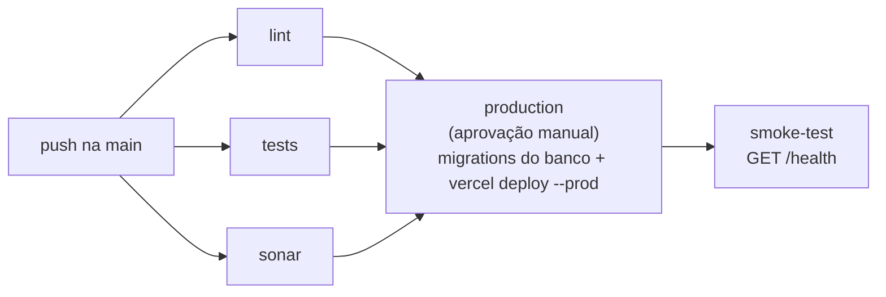
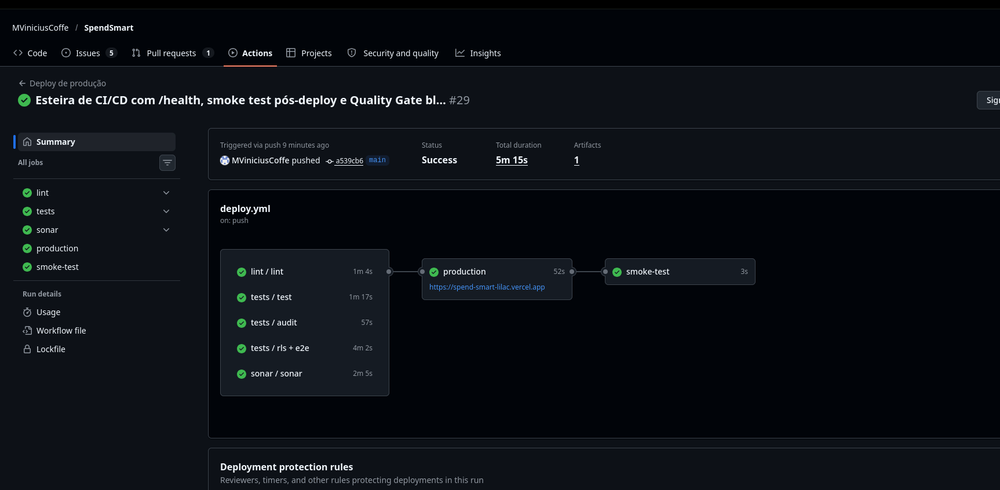
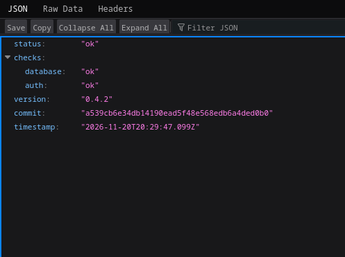
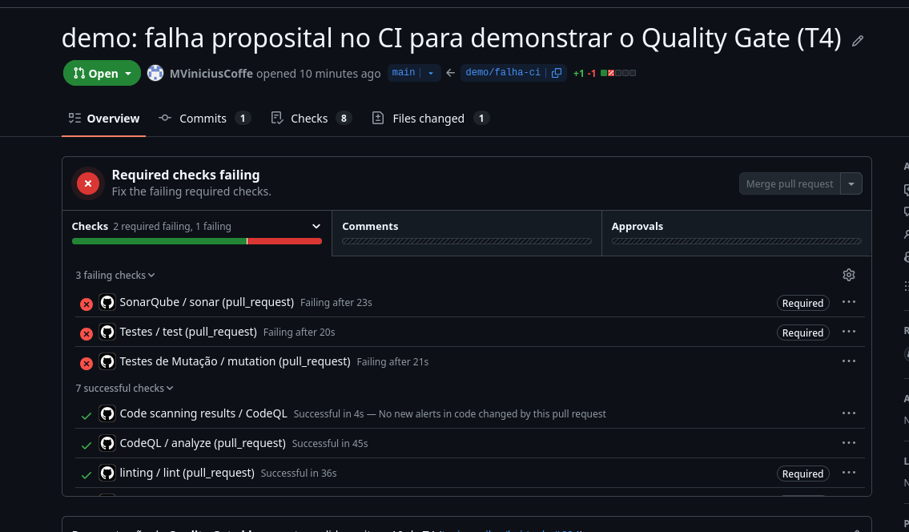
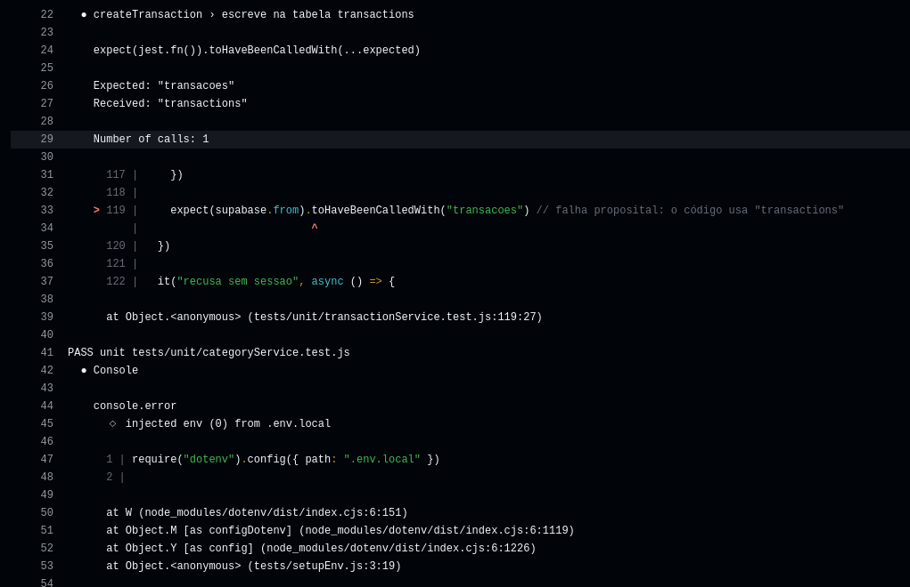
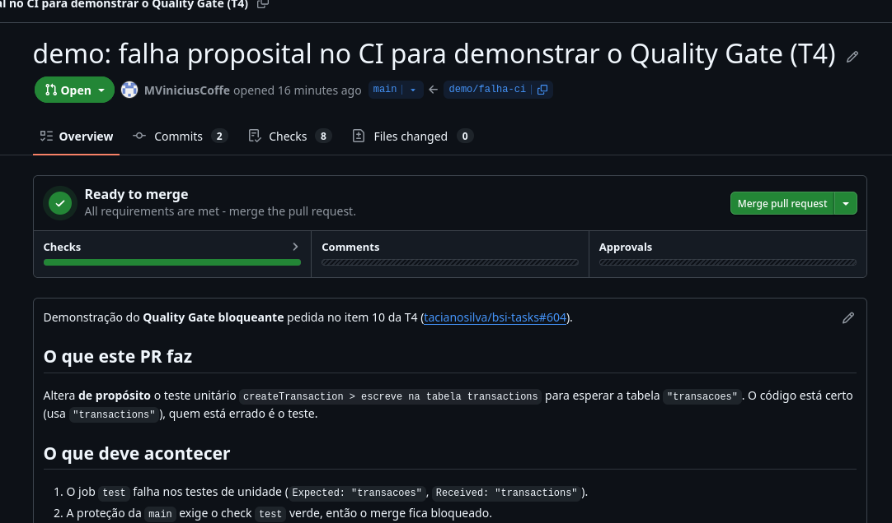
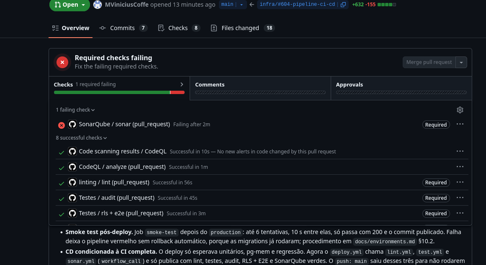
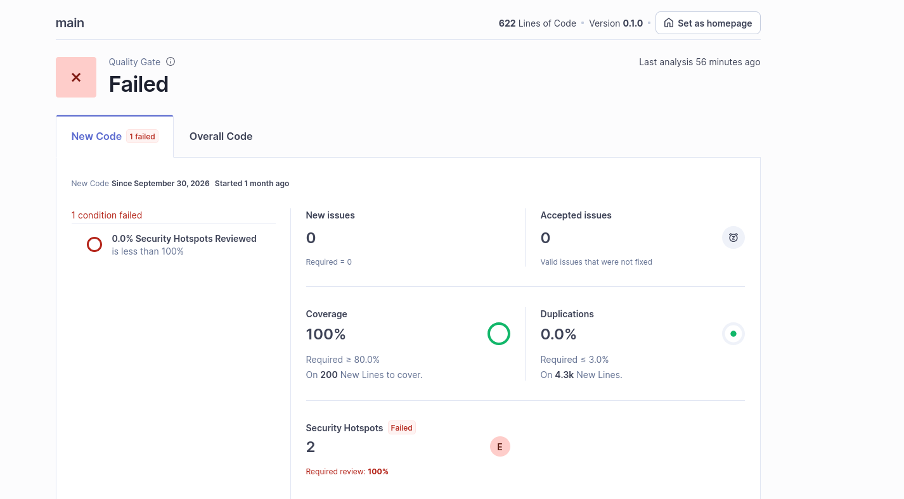

# Tarefa 04 - DevOps, Integração e Entrega Contínua (CI/CD) com Testes Automatizados

## Identificação

| Campo          | Valor                                                        |
| :------------- | :----------------------------------------------------------- |
| Nome completo  | Marcus Vinícius de Souza Azevedo                             |
| Usuário GitHub | [@MViniciusCoffe](https://github.com/MViniciusCoffe)         |
| E-mail         | vinicius.azevedo.123@ufrn.edu.br                             |
| Issue          | [#604](https://github.com/tacianosilva/bsi-tasks/issues/604) |

---

## Links de Entrega

| Entrega                                                | Link                                                                                                       |
| :----------------------------------------------------- | :--------------------------------------------------------------------------------------------------------- |
| Pull Request do workflow de CI/CD (SpendSmart)         | [SpendSmart #104](https://github.com/MViniciusCoffe/SpendSmart/pull/104)                                   |
| Aplicação publicada                                    | <https://spend-smart-lilac.vercel.app/>                                                                    |
| Checagem de integridade (`/health`)                    | <https://spend-smart-lilac.vercel.app/health>                                                              |
| Execução do pipeline de deploy (merge do PR #104)      | [Deploy de produção #29](https://github.com/MViniciusCoffe/SpendSmart/actions/runs/44811028671)            |
| Pull Request da simulação do Quality Gate              | [SpendSmart #106](https://github.com/MViniciusCoffe/SpendSmart/pull/106) (branch `demo/falha-ci`)          |
| Pull Request da entrega no `bsi-tasks`                 | _a preencher_                                                                                              |

A tarefa foi feita no [SpendSmart](https://github.com/MViniciusCoffe/SpendSmart), o mesmo projeto da
Tarefa 01 ([#449](https://github.com/tacianosilva/bsi-tasks/issues/449)). É um monolito Next.js 16 com
Supabase (Auth e PostgreSQL com RLS), desenvolvido em dupla com José Samuel Silva Lima, que entrega a
T4 dele no mesmo repositório. O pipeline, o `/health`, o smoke test e o Quality Gate bloqueante saíram
no PR #104, que é meu. O `Dockerfile` e o `docker-compose` ficam com o José, na P5.

---

## 1. Pesquisa e Fundamentação Teórica

### 1.1 Cultura DevOps e Testes Contínuos

#### Do cascata ao ágil: onde o teste ficava

O modelo em cascata é quase sempre lembrado pelo artigo de Winston Royce (1970), com as fases em
sequência: requisitos, análise, projeto, codificação, teste e operação. O curioso é que o próprio
Royce apresentou essa sequência pura como arriscada. Ele escreveu que o teste no fim é o primeiro
momento em que o sistema é de fato experimentado, e que um problema descoberto ali pode obrigar a
refazer o projeto inteiro. Mesmo assim, foi a versão sequencial que a indústria adotou.

Nesse arranjo o teste é uma fase, e o testador é a pessoa que recebe o sistema pronto. Desenvolvimento
e QA viram equipes separadas, com uma passagem de bastão entre elas, e o defeito anda de mão em mão por
relatório. Quanto mais tarde o defeito aparece, mais código foi construído em cima dele, e mais caro
fica corrigir.

O Manifesto Ágil (Beck et al., 2001) atacou essa distância por outro lado. Entregar software
funcionando em ciclos curtos obriga a testar em ciclos curtos. Práticas da Extreme Programming, como o
TDD e a integração contínua, colocaram o teste dentro do trabalho do desenvolvedor, e Crispin e Gregory
(2009) descrevem o testador ágil como membro do time, presente desde a conversa sobre a história de
usuário. A pergunta muda de "o sistema passou no teste?" para "como vamos saber que esta história está
pronta?", e os critérios de aceitação em Gherkin que usamos nas Tarefas 02 e 03 são exatamente isso.

#### O "muro da confusão" e a cultura DevOps

O ágil aproximou desenvolvimento e QA, mas parou na porta da operação. O time terminava a sprint com o
software "pronto" e o entregava para outra equipe colocar no ar. A expressão "muro da confusão",
popularizada por Andrew Clay Shafer, descreve esse momento. De um lado, o desenvolvimento é cobrado por
mudança rápida. Do outro, a operação é cobrada por estabilidade, e para ela toda mudança é risco. Cada
um otimiza a própria meta e o código é jogado por cima do muro.

DevOps surge em 2009, com Patrick Debois organizando o primeiro DevOpsDays e a palestra de John Allspaw
e Paul Hammond sobre os "10+ deploys por dia" no Flickr. A proposta é tratar mudança e estabilidade como
responsabilidade do mesmo time, e resolver o conflito com automação e feedback, não com mais burocracia.
Se o caminho até a produção é automático, testado e repetível, publicar deixa de ser um evento perigoso
e passa a ser rotina. No SpendSmart tentei fazer isso, e o mesmo pipeline que roda os testes aplica as
migrations, publica e verifica a produção.

#### Como o teste muda no DevOps, e o papel do QA

No cascata o teste é uma fase. No DevOps ele vira uma propriedade do pipeline, executado a cada mudança,
que é o que se chama de teste contínuo (*continuous testing*). O papel do QA muda junto. Executar roteiro
manual deixa de ser o centro do trabalho. O QA passa a decidir o que o pipeline precisa garantir (quais
testes, em que ordem, qual critério bloqueia), a escrever e manter a automação e a olhar para o que
acontece depois do deploy. Na nossa dupla, o QA revisa o PR do outro e a esteira aplica o resto.

#### Shift-Left Testing × Shift-Right Testing

O termo *shift-left* vem de Larry Smith (2001). Se a linha do tempo do projeto é desenhada da esquerda
para a direita, o teste deve se mover para a esquerda, para perto de quando o código é escrito. Na
prática isso é lint, teste de unidade, análise estática e revisão rodando antes do merge, e até antes
do commit, como nos hooks de pré-commit. O objetivo é achar o defeito quando ele ainda é barato.

O *shift-right* olha para o outro extremo. Algumas coisas só aparecem com o sistema publicado: a
variável de ambiente errada, o banco de produção fora, o domínio apontando para a versão antiga. Smoke
tests pós-deploy, monitoramento, observabilidade e estratégias como canary e blue/green são formas de
testar em produção com o risco controlado.

As duas abordagens se completam, e o SpendSmart tem as duas. O lado esquerdo é a CI do PR (ESLint,
Prettier, `check-agents.js`, unidade, integração, regressão, E2E e SonarQube). O lado direito é o job
`smoke-test`, que chama o `/health` publicado e confere se respondeu o commit que acabou de entrar.

### 1.2 CI, Entrega Contínua e Implantação Contínua

**Integração Contínua** (Fowler, 2006) é integrar o código de todos na linha principal com frequência,
várias vezes ao dia, e verificar cada integração com build e testes automáticos. O produto da CI é
informação, a resposta para "este commit quebrou alguma coisa?".

**Entrega Contínua** (Humble e Farley, 2010) vai além. Todo commit que passa pela esteira gera uma versão
que *pode* ir para produção a qualquer momento, com o caminho até lá automatizado. A decisão de publicar
continua humana.

**Implantação Contínua** tira essa decisão. Todo commit que passa nos testes vai para produção sem
ninguém aprovar, e por isso exige muita confiança na suíte de testes e no monitoramento.

A diferença prática é uma pessoa clicando em "aprovar". O SpendSmart faz entrega contínua, porque o
`deploy.yml` roda sozinho até o environment `Production` e ali espera a aprovação. Escolhi parar ali porque
o mesmo job aplica migrations no banco de produção, e uma migration não se desfaz como um deploy da
Vercel. Se um dia as migrations forem sempre compatíveis com a versão anterior do código, dá para tirar
a aprovação e chegar à implantação contínua.

### 1.3 O papel dos testes na esteira de CI/CD

#### Quality Gate, e por que uma esteira sem testes não é entrega contínua segura

Um *Quality Gate* é um critério automático que a mudança precisa cumprir para seguir adiante: todos os
testes passando, cobertura mínima no código novo, nenhuma vulnerabilidade alta, nenhum hotspot de
segurança sem revisão. O ponto principal é que o critério bloqueia. Uma checagem que só gera relatório
é informação, não portão.

Sem testes, a esteira automatiza só o transporte. Ela leva para produção, com rapidez e repetibilidade,
qualquer coisa que compile, inclusive o defeito. Entrega contínua promete que cada versão está pronta
para produção, e quem sustenta essa promessa são os testes. Vivi isso no próprio SpendSmart. O Quality
Gate do SonarQube ficou vermelho de setembro até novembro sem ninguém perceber, porque o job não esperava
o resultado (seção 5.2).

#### A pirâmide de testes ao longo do pipeline (Fail-Fast)

A pirâmide de testes (Cohn, 2009) põe muitos testes de unidade na base, menos testes de integração no
meio e poucos testes de sistema no topo. Subindo a pirâmide, cada teste fica mais lento, mais caro e mais
frágil. No pipeline a pirâmide vira uma ordem no tempo. O barato e rápido roda primeiro, para o
desenvolvedor saber em segundos que quebrou algo, sem esperar o E2E.

Esse é o princípio *fail-fast* (Shore, 2004). Um sistema deve falhar no primeiro sinal de problema, de
forma visível e perto da causa, em vez de seguir adiante e falhar mais tarde, longe dela. Na execução #29
do SpendSmart, o `lint` levou 1min04s e o job `test` (unidade com cobertura, depois pg-mem, depois
regressão) levou 1min17s, enquanto o `rls + e2e` levou 4min02s. Dentro do job `test`, se um teste de
unidade falha, a integração nem começa.

O Git tem um exemplo pequeno do mesmo princípio, no `git push --force` e no `git push
--force-with-lease`. O `--force` sobrescreve a branch remota sem perguntar nada. Se outra pessoa enviou
commits nesse meio-tempo, eles somem em silêncio, e a falha só aparece dias depois, quando alguém
procura o código. O `--force-with-lease` só sobrescreve se a branch remota ainda estiver no commit que
você conhecia no último `fetch`. Se ela mudou, o push é recusado na hora, com mensagem de erro, e nada é
perdido. A documentação do Git avisa de uma brecha. Um `fetch` em segundo plano (de um editor, por
exemplo) atualiza essa referência e desarma a proteção. O `--force-if-includes`, do Git 2.30, existe
para fechar essa brecha. Na `main` do SpendSmart a regra de proteção vai um passo além e proíbe o force
push de vez.

#### A pirâmide na era da IA

Na Tarefa 01 descrevi a pirâmide e citei o troféu de testes (Dodds, 2021) como versão mais atual. O
troféu acrescenta a análise estática na base e engorda a camada de integração, com o argumento de que
ela dá mais confiança por teste escrito. As duas figuras partem da mesma premissa econômica. Teste de
sistema é caro de escrever, caro de manter e lento de rodar, então deve haver poucos.

A IA mexeu em parte dessa premissa. Escrever teste ficou barato. Um agente gera um `.spec.js` do
Playwright a partir do critério de aceitação em minutos, e foi assim que o ST-01 do SpendSmart começou
na P3. Executar não ficou mais barato. O E2E continua levando minutos no CI e continua sujeito a
instabilidade, então a ordem do pipeline (rápido primeiro, lento depois) vale do mesmo jeito. O que
muda é a desculpa para ter poucos testes de sistema, que deixa de ser o custo de escrita e passa a ser
só o tempo de feedback.

A IA também criou uma camada que a pirâmide não tinha, o teste instrumental, em que um agente opera a
aplicação no navegador e decide o próximo passo. Na P3 comparamos as duas formas sobre a mesma
especificação. O script rodou 11 testes em 34 s, sem achados novos. O agente levou cerca de 20 minutos,
achou uma regressão que nenhum teste pegava (uma caixa de erro vazia no cadastro) e reproduziu pela
primeira vez um defeito conhecido, a #76. Só que o agente não é determinístico, então não serve de
portão. No nosso caso, o agente explora fora do pipeline, a equipe confirma o achado e um script passa
a cobrir o cenário dentro do pipeline.

O risco maior aparece quando a IA escreve o código e também os testes. Um teste gerado a partir do
código confirma o que o código faz, inclusive o defeito, porque a IA não sabe o que o sistema deveria
fazer (o problema do oráculo). Cobertura alta deixa de provar alguma coisa. Por isso faz sentido
reforçar os portões que medem o próprio teste. O SpendSmart roda teste de mutação com o Stryker, que
altera o código de propósito e confere se algum teste falha, e o Quality Gate do SonarQube cobra
cobertura do código novo. Os critérios de aceitação escritos antes, em Gherkin, continuam sendo a
referência do que é certo. O relatório DORA de 2024 aponta na mesma direção, ao associar o aumento do
uso de IA no desenvolvimento a uma queda na estabilidade das entregas. Com mais código chegando mais
rápido, o portão de qualidade importa mais.

### 1.4 Estratégias de deploy e gerenciamento de segredos

#### Recreate, Rolling Update e Blue/Green

**Recreate.** A versão antiga é desligada inteira e a nova é ligada no lugar. É simples e nunca há duas
versões rodando ao mesmo tempo, mas o sistema fica fora do ar no intervalo. Serve quando a parada é
aceitável ou quando as duas versões não podem coexistir.

**Rolling Update.** As instâncias são trocadas aos poucos. Algumas recebem a versão nova, passam na
checagem de saúde e só então o próximo lote é trocado. Não há indisponibilidade, mas durante a troca as
duas versões atendem usuários ao mesmo tempo, então banco e API precisam aceitar as duas. É a estratégia
padrão de um Deployment no Kubernetes.

**Blue/Green** (Fowler, 2010). Existem dois ambientes completos. O azul atende os usuários e o verde
recebe a versão nova, onde é testado sem tráfego real. Quando o verde está validado, o roteador ou o
balanceador troca todo o tráfego de uma vez. Se der problema, a volta é trocar o roteamento de novo,
em segundos. O custo é manter dois ambientes.

Sites publicados na Vercel funcionam de um jeito parecido com blue/green. Cada deploy é imutável e tem
URL própria, e o domínio de produção é só um apontamento para um deles. Publicar é mover o domínio para
o deploy novo, e o *Instant Rollback* é movê-lo de volta. Foi justamente esse apontamento que motivou o
smoke test do SpendSmart a conferir o commit (seção 4). Depois de um rollback, o domínio para de seguir
os deploys novos, e um `200` sozinho viria da versão antiga.

Na AWS as três estratégias aparecem como opções de configuração, o que ajuda a enxergar a diferença
entre elas. No Elastic Beanstalk, a política de deploy de um ambiente é escolhida no console. *All at
once* atualiza todas as instâncias de uma vez e deixa o site fora do ar por um momento, o equivalente
ao Recreate. *Rolling* atualiza por lotes, tirando cada lote do balanceador enquanto ele é trocado, e
*Rolling with additional batch* sobe um lote extra antes, para não perder capacidade. *Immutable* cria
instâncias novas ao lado das antigas e só descarta as antigas quando as novas estão saudáveis. O
blue/green no Beanstalk é feito com dois ambientes e a ação *Swap environment URLs*, que troca o
endereço (o CNAME) de um ambiente pelo do outro.

No CodeDeploy a escolha fica mais explícita. Um deploy *in-place* troca a versão nas instâncias
existentes, e a configuração define o ritmo (uma por vez, metade por vez ou todas de uma vez). Um
deploy *blue/green* sobe um conjunto novo de instâncias, ou de tarefas no ECS, e o Application Load
Balancer passa o tráfego do grupo antigo (*target group*) para o novo. No ECS e no Lambda essa passagem
pode ser gradual, por exemplo 10% do tráfego primeiro e o resto alguns minutos depois, que é um canary.

Em todas essas opções a decisão de seguir ou voltar depende de uma checagem de saúde. O balanceador
chama periodicamente um caminho da aplicação e só manda tráfego para a instância que responde 200. É o
mesmo papel do `/health` do SpendSmart, que responde 503 quando o banco ou o Auth caem.

#### Secrets management no GitHub Actions

Um segredo no repositório é um segredo publicado. Qualquer pessoa com acesso ao código, a um fork ou a
um clone antigo tem a chave, e robôs varrem o GitHub público atrás delas. O GitHub Actions resolve a
parte de uso com os *secrets*. O valor fica criptografado, aparece mascarado nos logs e só chega aos
jobs que o referenciam. Secrets de um *environment* vão além e só chegam aos jobs daquele environment.
No SpendSmart o token da Vercel e a URL do banco de produção estão no environment `Production`, então
nem um job da CI comum nem um PR conseguem lê-los, só o job de deploy aprovado.

A outra parte é impedir que o segredo entre no código, e aqui a ferramenta é a expressão regular.
Muitas chaves têm formato reconhecível. Um ID de chave de acesso da AWS segue `AKIA[0-9A-Z]{16}`, e um
JWT começa com `eyJ` porque é o `{"` do cabeçalho codificado em base64. O `check-agents.js` do
SpendSmart usa exatamente essas expressões, `/sb_secret_[a-zA-Z0-9_-]{20,}/` para a chave secreta do
Supabase e `/eyJ[a-zA-Z0-9_-]{20,}\./` para JWTs, e roda no `lint.yml` a cada PR. A regex só encontra
formatos conhecidos. Por isso ferramentas como o plugin `no-secrets` do ESLint também medem a entropia
das strings, já que uma senha aleatória tem cara de ruído. O preço são os falsos positivos, como os dois
hotspots do SonarQube na seção 5.2, disparados pelo nome `same_password` de uma mensagem de erro.

No curso.dev montei essa proteção no
[clone-tabnews (PR #21)](https://github.com/MViniciusCoffe/clone-tabnews/pull/21), ainda aberto, como um
hook de pré-commit. O Husky chama o lint-staged, que roda o `secretlint` (preset recomendado, com regras
para AWS e GCP) em todo arquivo do commit e o ESLint com os plugins `no-secrets` e `security` nos
arquivos JavaScript. É shift-left no extremo, porque o segredo é barrado antes de virar commit. Um hook
local, porém, é opcional, e `git commit --no-verify` passa por cima dele. Por isso a mesma verificação
precisa rodar também num workflow da CI, onde ninguém consegue pular, como o `check-agents.js` faz no
SpendSmart.

Barrar antes é tão importante porque remover depois é difícil. Um commit que apaga a chave não a remove
do histórico, e ela continua em todos os commits anteriores. Tirar de verdade exige reescrever o
histórico com `git filter-repo` ou BFG, e cada commit desde o vazamento ganha um novo hash. Depois vem
um force push (de novo o `--force-with-lease`), e todo mundo que tinha um clone precisa descartá-lo e
clonar de novo. Mesmo assim, forks, clones antigos e caches continuam com a chave. A única correção
garantida é revogar a chave e gerar outra. Reescrever o histórico só limpa o repositório depois que o
segredo já deixou de valer.

### Referências

- ALLSPAW, J.; HAMMOND, P. *10+ Deploys Per Day: Dev and Ops Cooperation at Flickr*. Velocity Conference, 2009.
- AWS. *Deployment policies and settings* (AWS Elastic Beanstalk Developer Guide). Disponível em: <https://docs.aws.amazon.com/elasticbeanstalk/latest/dg/using-features.rolling-version-deploy.html>.
- AWS. *Blue/Green deployments with Elastic Beanstalk*. Disponível em: <https://docs.aws.amazon.com/elasticbeanstalk/latest/dg/using-features.CNAMESwap.html>.
- AWS. *Working with deployment configurations in CodeDeploy*. Disponível em: <https://docs.aws.amazon.com/codedeploy/latest/userguide/deployment-configurations.html>.
- BECK, K. et al. *Manifesto para Desenvolvimento Ágil de Software*. 2001. Disponível em: <https://agilemanifesto.org/iso/ptbr/manifesto.html>.
- COHN, M. *Succeeding with Agile: Software Development Using Scrum*. Addison-Wesley, 2009.
- CRISPIN, L.; GREGORY, J. *Agile Testing: A Practical Guide for Testers and Agile Teams*. Addison-Wesley, 2009.
- DODDS, K. C. *The Testing Trophy and Testing Classifications*. 2021. Disponível em: <https://kentcdodds.com/blog/the-testing-trophy-and-testing-classifications>.
- DORA. *Accelerate State of DevOps Report 2024*. Google Cloud, 2024. Disponível em: <https://dora.dev/research/2024/dora-report/>.
- FOWLER, M. *Continuous Integration*. 2006. Disponível em: <https://martinfowler.com/articles/continuousIntegration.html>.
- FOWLER, M. *BlueGreenDeployment*. 2010. Disponível em: <https://martinfowler.com/bliki/BlueGreenDeployment.html>.
- GIT. *git-push Documentation* (`--force-with-lease`, `--force-if-includes`). Disponível em: <https://git-scm.com/docs/git-push>.
- GITHUB. *Using secrets in GitHub Actions*. Disponível em: <https://docs.github.com/en/actions/security-for-github-actions/security-guides/using-secrets-in-github-actions>.
- GITHUB. *Removing sensitive data from a repository*. Disponível em: <https://docs.github.com/en/authentication/keeping-your-account-and-data-secure/removing-sensitive-data-from-a-repository>.
- HUMBLE, J.; FARLEY, D. *Continuous Delivery: Reliable Software Releases through Build, Test, and Deployment Automation*. Addison-Wesley, 2010.
- KUBERNETES. *Deployments* (estratégias `Recreate` e `RollingUpdate`). Disponível em: <https://kubernetes.io/docs/concepts/workloads/controllers/deployment/>.
- ROYCE, W. W. *Managing the Development of Large Software Systems*. Proceedings of IEEE WESCON, 1970.
- SHORE, J. *Fail Fast*. IEEE Software, v. 21, n. 5, 2004.
- SMITH, L. *Shift-Left Testing*. Dr. Dobb's Journal, 2001.

---

## 2. Pipeline de Integração Contínua (CI)

O enunciado sugere um único `.github/workflows/ci.yml`. Mantive a divisão por responsabilidade que o
SpendSmart usa desde a Tarefa 01, porque assim cada workflow vira um check separado no PR e dá para ver
o que quebrou sem abrir o log. Todos rodam em `pull_request` para a `main`. No push para a `main`, o
`deploy.yml` chama os mesmos workflows via `workflow_call`, então o código que roda nos dois eventos é
o mesmo.

| Workflow     | Job          | O que executa                                                                                                         |
| :----------- | :----------- | :-------------------------------------------------------------------------------------------------------------------- |
| `lint.yml`   | `lint`       | `npm ci` com cache do npm → ESLint → Prettier → `check-agents.js` (regras do projeto: sem `select("*")`, sem chave secreta no front etc.) |
| `test.yml`   | `test`       | `npm ci` com cache → **testes de unidade com cobertura** (`npm run test:coverage`, 241 testes, 100% em `src/services/`) → **integração** com pg-mem (27) → **regressão** (78) |
| `test.yml`   | `audit`      | `npm audit --audit-level=high` (dependências com vulnerabilidade alta)                                                 |
| `test.yml`   | `rls + e2e`  | Supabase local no runner → **integração contra o banco real** (RLS, triggers, 36 testes) → **testes de sistema** Playwright + axe (19) |
| `sonar.yml`  | `sonar`      | Testes com cobertura → análise do SonarQube (LABENS UFRN), com o **Quality Gate bloqueante** (`sonar.qualitygate.wait=true`) |
| `codeql.yml` | `analyze`    | Análise de segurança CodeQL (`security-extended`)                                                                      |

A cobertura sai do `test:coverage`, que gera o `lcov` lido pelo SonarQube. O painel do projeto
`spendsmart` no LABENS mostrou 100% de cobertura no código novo do PR #104.

Um teste que falha derruba o job. A `main` é protegida e só recebe código por PR, com os checks `lint`,
`test`, `audit`, `rls + e2e` e `sonar` obrigatoriamente verdes, inclusive para administradores. O job
do Sonar mudou nesta tarefa. Antes ele enviava a análise e terminava sem esperar o veredito. Agora
espera, e falha junto com o Quality Gate.

---

## 3. Pipeline de Entrega/Implantação Contínua (CD)

O `deploy.yml` roda a cada push na `main` (ou seja, a cada merge):



1. **CI completa de novo** (`lint`, `tests`, `sonar`), sobre o commit que entrou na `main`.
2. **`production`**: usa o environment `Production` do GitHub, que exige **aprovação manual** antes
   de rodar. Aplica as migrations pendentes no Supabase de produção (primeiro um dry-run, depois o
   `db push`) e publica na Vercel com `vercel deploy --prod`, passando o commit como `APP_COMMIT_SHA`.
3. **`smoke-test`**: verificação pós-deploy (seção 4).

Tudo é automático até a porta de produção, e ali uma pessoa aprova. Então o projeto faz **entrega
contínua** (*Continuous Delivery*), e não implantação contínua. Escolhi a aprovação porque o mesmo job
aplica migrations no banco de produção, e migration não tem desfazer automático.

O enunciado aceita `Dockerfile` *ou* artefato empacotado. Aqui o artefato é o build do Next.js que a
Vercel gera e publica, imutável, um por deploy. Cada deploy tem URL própria, o que permite voltar a um
anterior. O `Dockerfile` multi-stage e o `docker-compose` serão entregues pelo José na P5.

Nenhum segredo fica no repositório. O token da Vercel, os IDs do projeto e a URL do banco de produção
são secrets do environment `Production`, e só o job aprovado os lê. O token do SonarQube é secret do
repositório. A aplicação usa só a chave pública do Supabase (nunca a `service_role`), e o
`check-agents.js` barra no CI qualquer chave secreta ou JWT commitado.

---

## 4. Verificação Pós-Deploy (Smoke Test)

O endpoint é o [`/health`](https://spend-smart-lilac.vercel.app/health)
([`src/app/health/route.js`](https://github.com/MViniciusCoffe/SpendSmart/blob/main/src/app/health/route.js)),
uma checagem de **prontidão** (*readiness*). Ele responde `200` só quando o banco (função
`health_check()` do Postgres) e o Auth do Supabase respondem. Se qualquer um falhar ou demorar mais de
3 s, a resposta é `503`. Nada vai para cache, e nenhuma mensagem de erro interna aparece no corpo.

```json
{
  "status": "ok",
  "checks": { "database": "ok", "auth": "ok" },
  "version": "0.4.2",
  "commit": "a539cb6e34db14190ead5f48e568edb6a4ded0b0",
  "timestamp": "2026-11-20T20:29:47.099Z"
}
```

No pipeline, o job `smoke-test` faz `GET /health` na URL de produção. São até 6 tentativas com 10 s
entre elas, porque o deploy leva alguns segundos para assumir o domínio. O job só passa com **`200` e o
`commit` igual ao que acabou de ser publicado**.

O `200` sozinho não bastava. Depois de um rollback manual na Vercel, os deploys novos deixam de assumir
o domínio de produção, e o smoke test receberia `200` da versão antiga. O pipeline ficaria verde com a
versão nova fora do ar. A decisão está registrada em
[`docs/tooling-decisions.md` §31](https://github.com/MViniciusCoffe/SpendSmart/blob/main/docs/tooling-decisions.md).

O próprio endpoint tem 13 testes de regressão. Eles cobrem o `200`, os casos de `503` (banco fora, erro
do PostgREST, tempo esgotado, Auth fora, configuração ausente), o `no-store` e a ausência de mensagem
interna. Um teste E2E chama o `/health` contra o Supabase local no CI.

Na execução [Deploy de produção #29](https://github.com/MViniciusCoffe/SpendSmart/actions/runs/44811028671)
todos os jobs passaram, e o `/health` publicado devolve o commit do merge (`a539cb6`).





---

## 5. Simulação Prática do Quality Gate

### 5.1 Teste quebrado de propósito (`demo/falha-ci`)

Na branch `demo/falha-ci` alterei o teste unitário `createTransaction > escreve na tabela transactions`
para esperar a tabela `"transacoes"`. O código usa `"transactions"`, então o código está certo e o teste
está errado. Abri o [PR #106](https://github.com/MViniciusCoffe/SpendSmart/pull/106) para a `main`.

| Passo                                              | Commit                                                                         | Resultado                                              |
| :------------------------------------------------- | :----------------------------------------------------------------------------- | :----------------------------------------------------- |
| Teste alterado para falhar                         | [`fdcd531`](https://github.com/MViniciusCoffe/SpendSmart/commit/fdcd531)       | `test`, `sonar` e `mutation` vermelhos, merge bloqueado |
| Correção do teste e esteira verde de novo          | [`ac7759f`](https://github.com/MViniciusCoffe/SpendSmart/commit/ac7759f)       | Todos os checks verdes, "Ready to merge"               |

Uma única asserção errada parou três checks. O `test` falhou pelo próprio teste. O `sonar` roda os
testes com cobertura antes da análise e parou no mesmo ponto. O `mutation` (Stryker) precisa da suíte
verde antes de gerar os mutantes. Os três falharam em cerca de 20 s, enquanto o `rls + e2e`, que não
roda os testes de unidade, levou 3 min e passou. Dois dos três são checks obrigatórios da `main`, e o
GitHub desabilitou o botão de merge.





O deploy de produção só roda no push para a `main`. Como o merge ficou bloqueado, o `deploy.yml` nem
começou, e a última execução dele continua sendo a #29, do merge do PR #104. O check `Vercel` aparece
verde no PR porque a Vercel publica um *Preview* de toda branch, numa URL própria e ligado ao projeto
Supabase de Preview. A produção não foi tocada.

Depois do commit de correção a esteira voltou a ficar verde e o merge foi liberado. O `mutation` não
rodou dessa vez porque o diff final do PR contra a `main` ficou vazio, e o workflow só roda quando o PR
muda `src/services/` ou os testes. Deixei o PR aberto, sem merge, como registro da demonstração.



### 5.2 Caso real: o Quality Gate do SonarQube barrando o PR #104

O primeiro PR barrado pelo Quality Gate bloqueante foi o próprio PR #104. A única condição que falhou
foi *"0.0% Security Hotspots Reviewed is less than 100%"*. Eram dois *security hotspots* da regra de
senha no código, em `src/services/profileService.js`, nas chaves `same_password` e `weak_password`.
Essas chaves são nomes de mensagens de erro exibidas ao usuário, e não senhas, então os dois eram falsos
positivos. Revisei os dois no painel e marquei como *Safe*, com a justificativa. Rodei o check de novo
e o Quality Gate passou, sem afrouxar a regra nem mudar o código.

Os dois hotspots existiam desde setembro. Durante esse tempo o Quality Gate ficou vermelho no painel
e ninguém viu, porque o job não esperava o resultado.





---

## 6. Adaptações em relação ao enunciado

| Enunciado                                      | No SpendSmart                                                                                                  | Por quê                                                                                         |
| :--------------------------------------------- | :------------------------------------------------------------------------------------------------------------- | :---------------------------------------------------------------------------------------------- |
| Um `ci.yml`                                    | `lint.yml`, `test.yml`, `sonar.yml`, `codeql.yml`, reutilizados pelo `deploy.yml`                              | Divisão existente desde a T1, cada check aparece separado no PR                                |
| CI em push e PR para a `main`                  | PR para a `main`. No push, a mesma CI roda dentro do `deploy.yml`                                              | Evita rodar a CI duas vezes no mesmo commit                                                     |
| `Dockerfile` ou artefato                       | Artefato do build da Vercel                                                                                    | O deploy é na Vercel. O `Dockerfile` vem na P5 (José)                                           |
| Deploy automático após merge                   | Automático até o environment `Production`, que pede aprovação                                                 | O deploy também aplica migrations no banco de produção                                          |
| Smoke test verificando `200 OK`                | `200` **e** o commit publicado, com 6 tentativas                                                               | Não validar a versão antiga depois de um rollback                                              |
