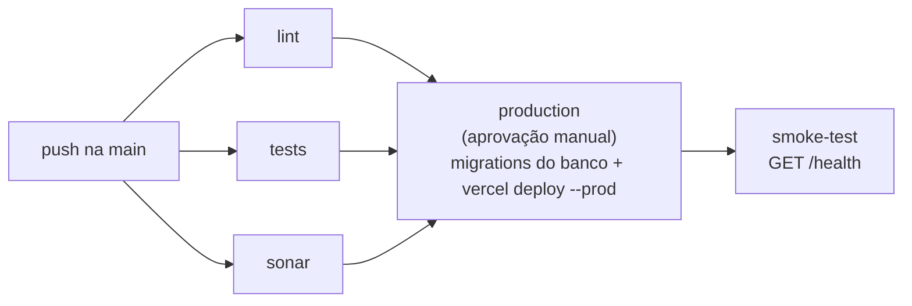

# Tarefa 04 - DevOps, Integração e Entrega Contínua (CI/CD) com Testes Automatizados

## Identificação

| Campo          | Valor                                                        |
| :------------- | :----------------------------------------------------------- |
| Nome completo  | Marcus Vinícius de Souza Azevedo                             |
| Usuário GitHub | [@MViniciusCoffe](https://github.com/MViniciusCoffe)         |
| E-mail         | vinicius.azevedo.123@ufrn.edu.br                             |
| Issue          | [#604](https://github.com/tacianosilva/bsi-tasks/issues/604) |

---

## Links de Entrega

| Entrega                                                | Link                                                                                                       |
| :----------------------------------------------------- | :--------------------------------------------------------------------------------------------------------- |
| Pull Request do workflow de CI/CD (SpendSmart)         | [SpendSmart #104](https://github.com/MViniciusCoffe/SpendSmart/pull/104)                                   |
| Aplicação publicada                                    | <https://spend-smart-lilac.vercel.app/>                                                                    |
| Checagem de integridade (`/health`)                    | <https://spend-smart-lilac.vercel.app/health>                                                              |
| Execução do pipeline de deploy (merge do PR #104)      | [Deploy de produção #29](https://github.com/MViniciusCoffe/SpendSmart/actions/runs/44811028671)            |
| Pull Request da simulação do Quality Gate              | _a preencher (branch `demo/falha-ci`)_                                                                     |
| Pull Request da entrega no `bsi-tasks`                 | _a preencher_                                                                                              |

A tarefa foi feita no [SpendSmart](https://github.com/MViniciusCoffe/SpendSmart), o mesmo projeto da
Tarefa 01 ([#449](https://github.com/tacianosilva/bsi-tasks/issues/449)). É um monolito Next.js 16 com
Supabase (Auth e PostgreSQL com RLS), desenvolvido em dupla com José Samuel Silva Lima, que entrega a
T4 dele no mesmo repositório. O pipeline, o `/health`, o smoke test e o Quality Gate bloqueante saíram
no PR #104, que é meu. O `Dockerfile` e o `docker-compose` ficam com o José, na P5.

---

## 1. Pesquisa e Fundamentação Teórica

<!-- TODO (Marcus): responder com as próprias palavras e citar as fontes. -->

### 1.1 Cultura DevOps e Testes Contínuos

#### O que é a cultura DevOps e como ela supera o "muro da confusão"

#### Como o teste de software muda do cascata para o DevOps, e o papel do QA

#### Shift-Left Testing × Shift-Right Testing

### 1.2 CI, Entrega Contínua e Implantação Contínua

### 1.3 O papel dos testes na esteira de CI/CD

#### Quality Gate, e por que uma esteira sem testes não é entrega contínua segura

#### A pirâmide de testes ao longo do pipeline (Fail-Fast)

### 1.4 Estratégias de deploy e gerenciamento de segredos

#### Recreate, Rolling Update e Blue/Green

#### Secrets management no GitHub Actions

### Referências

---

## 2. Pipeline de Integração Contínua (CI)

O enunciado sugere um único `.github/workflows/ci.yml`. Mantive a divisão por responsabilidade que o
SpendSmart usa desde a Tarefa 01, porque assim cada workflow vira um check separado no PR e dá para ver
o que quebrou sem abrir o log. Todos rodam em `pull_request` para a `main`. No push para a `main`, o
`deploy.yml` chama os mesmos workflows via `workflow_call`, então o código que roda nos dois eventos é
o mesmo.

| Workflow     | Job          | O que executa                                                                                                         |
| :----------- | :----------- | :-------------------------------------------------------------------------------------------------------------------- |
| `lint.yml`   | `lint`       | `npm ci` com cache do npm → ESLint → Prettier → `check-agents.js` (regras do projeto: sem `select("*")`, sem chave secreta no front etc.) |
| `test.yml`   | `test`       | `npm ci` com cache → **testes de unidade com cobertura** (`npm run test:coverage`, 241 testes, 100% em `src/services/`) → **integração** com pg-mem (27) → **regressão** (78) |
| `test.yml`   | `audit`      | `npm audit --audit-level=high` (dependências com vulnerabilidade alta)                                                 |
| `test.yml`   | `rls + e2e`  | Supabase local no runner → **integração contra o banco real** (RLS, triggers, 36 testes) → **testes de sistema** Playwright + axe (19) |
| `sonar.yml`  | `sonar`      | Testes com cobertura → análise do SonarQube (LABENS UFRN), com o **Quality Gate bloqueante** (`sonar.qualitygate.wait=true`) |
| `codeql.yml` | `analyze`    | Análise de segurança CodeQL (`security-extended`)                                                                      |

A cobertura sai do `test:coverage`, que gera o `lcov` lido pelo SonarQube. O painel do projeto
`spendsmart` no LABENS mostrou 100% de cobertura no código novo do PR #104.

Um teste que falha derruba o job. A `main` é protegida e só recebe código por PR, com os checks `lint`,
`test`, `audit`, `rls + e2e` e `sonar` obrigatoriamente verdes, inclusive para administradores. O job
do Sonar mudou nesta tarefa. Antes ele enviava a análise e terminava sem esperar o veredito. Agora
espera, e falha junto com o Quality Gate.

---

## 3. Pipeline de Entrega/Implantação Contínua (CD)

O `deploy.yml` roda a cada push na `main` (ou seja, a cada merge):



1. **CI completa de novo** (`lint`, `tests`, `sonar`), sobre o commit que entrou na `main`.
2. **`production`**: usa o environment `Production` do GitHub, que exige **aprovação manual** antes
   de rodar. Aplica as migrations pendentes no Supabase de produção (primeiro um dry-run, depois o
   `db push`) e publica na Vercel com `vercel deploy --prod`, passando o commit como `APP_COMMIT_SHA`.
3. **`smoke-test`**: verificação pós-deploy (seção 4).

Tudo é automático até a porta de produção, e ali uma pessoa aprova. Então o projeto faz **entrega
contínua** (*Continuous Delivery*), e não implantação contínua. Escolhi a aprovação porque o mesmo job
aplica migrations no banco de produção, e migration não tem desfazer automático.

O enunciado aceita `Dockerfile` *ou* artefato empacotado. Aqui o artefato é o build do Next.js que a
Vercel gera e publica, imutável, um por deploy. Cada deploy tem URL própria, o que permite voltar a um
anterior. O `Dockerfile` multi-stage e o `docker-compose` serão entregues pelo José na P5.

Nenhum segredo fica no repositório. O token da Vercel, os IDs do projeto e a URL do banco de produção
são secrets do environment `Production`, e só o job aprovado os lê. O token do SonarQube é secret do
repositório. A aplicação usa só a chave pública do Supabase (nunca a `service_role`), e o
`check-agents.js` barra no CI qualquer chave secreta ou JWT commitado.

---

## 4. Verificação Pós-Deploy (Smoke Test)

O endpoint é o [`/health`](https://spend-smart-lilac.vercel.app/health)
([`src/app/health/route.js`](https://github.com/MViniciusCoffe/SpendSmart/blob/main/src/app/health/route.js)),
uma checagem de **prontidão** (*readiness*). Ele responde `200` só quando o banco (função
`health_check()` do Postgres) e o Auth do Supabase respondem. Se qualquer um falhar ou demorar mais de
3 s, a resposta é `503`. Nada vai para cache, e nenhuma mensagem de erro interna aparece no corpo.

```json
{
  "status": "ok",
  "checks": { "database": "ok", "auth": "ok" },
  "version": "0.4.2",
  "commit": "a539cb6e34db14190ead5f48e568edb6a4ded0b0",
  "timestamp": "2026-11-20T20:29:47.099Z"
}
```

No pipeline, o job `smoke-test` faz `GET /health` na URL de produção. São até 6 tentativas com 10 s
entre elas, porque o deploy leva alguns segundos para assumir o domínio. O job só passa com **`200` e o
`commit` igual ao que acabou de ser publicado**.

O `200` sozinho não bastava. Depois de um rollback manual na Vercel, os deploys novos deixam de assumir
o domínio de produção, e o smoke test receberia `200` da versão antiga. O pipeline ficaria verde com a
versão nova fora do ar. A decisão está registrada em
[`docs/tooling-decisions.md` §31](https://github.com/MViniciusCoffe/SpendSmart/blob/main/docs/tooling-decisions.md).

O próprio endpoint tem 13 testes de regressão. Eles cobrem o `200`, os casos de `503` (banco fora, erro
do PostgREST, tempo esgotado, Auth fora, configuração ausente), o `no-store` e a ausência de mensagem
interna. Um teste E2E chama o `/health` contra o Supabase local no CI.

Na execução [Deploy de produção #29](https://github.com/MViniciusCoffe/SpendSmart/actions/runs/44811028671)
todos os jobs passaram, e o `/health` publicado devolve o commit do merge (`a539cb6`).

<!-- TODO: screenshot do grafo do pipeline (#29) e do /health -->

---

## 5. Simulação Prática do Quality Gate

### 5.1 Teste quebrado de propósito (`demo/falha-ci`)

<!-- TODO: preencher após o PR de demonstração -->

| Passo                                              | Evidência     |
| :------------------------------------------------- | :------------ |
| Teste alterado para falhar                         | _a preencher_ |
| PR com o check `test` vermelho e o merge bloqueado | _a preencher_ |
| Correção do teste e esteira verde de novo          | _a preencher_ |

O deploy só roda no push para a `main`, e a `main` exige os checks verdes. Com um teste quebrado, o
merge fica bloqueado e o `deploy.yml` nem começa.

### 5.2 Caso real: o Quality Gate do SonarQube barrando o PR #104

O primeiro PR barrado pelo Quality Gate bloqueante foi o próprio PR #104. A única condição que falhou
foi *"0.0% Security Hotspots Reviewed is less than 100%"*. Eram dois *security hotspots* da regra de
senha no código, em `src/services/profileService.js`, nas chaves `same_password` e `weak_password`.
Essas chaves são nomes de mensagens de erro exibidas ao usuário, e não senhas, então os dois eram falsos
positivos. Revisei os dois no painel e marquei como *Safe*, com a justificativa. Rodei o check de novo
e o Quality Gate passou, sem afrouxar a regra nem mudar o código.

Os dois hotspots existiam desde setembro. Durante esse tempo o Quality Gate ficou vermelho no painel
e ninguém viu, porque o job não esperava o resultado.

<!-- TODO: screenshots do antes (check sonar vermelho, painel Failed) e do depois (Passed) -->

---

## 6. Adaptações em relação ao enunciado

| Enunciado                                      | No SpendSmart                                                                                                  | Por quê                                                                                         |
| :--------------------------------------------- | :------------------------------------------------------------------------------------------------------------- | :---------------------------------------------------------------------------------------------- |
| Um `ci.yml`                                    | `lint.yml`, `test.yml`, `sonar.yml`, `codeql.yml`, reutilizados pelo `deploy.yml`                              | Divisão existente desde a T1, cada check aparece separado no PR                                |
| CI em push e PR para a `main`                  | PR para a `main`. No push, a mesma CI roda dentro do `deploy.yml`                                              | Evita rodar a CI duas vezes no mesmo commit                                                     |
| `Dockerfile` ou artefato                       | Artefato do build da Vercel                                                                                    | O deploy é na Vercel. O `Dockerfile` vem na P5 (José)                                           |
| Deploy automático após merge                   | Automático até o environment `Production`, que pede aprovação                                                 | O deploy também aplica migrations no banco de produção                                          |
| Smoke test verificando `200 OK`                | `200` **e** o commit publicado, com 6 tentativas                                                               | Não validar a versão antiga depois de um rollback                                              |
