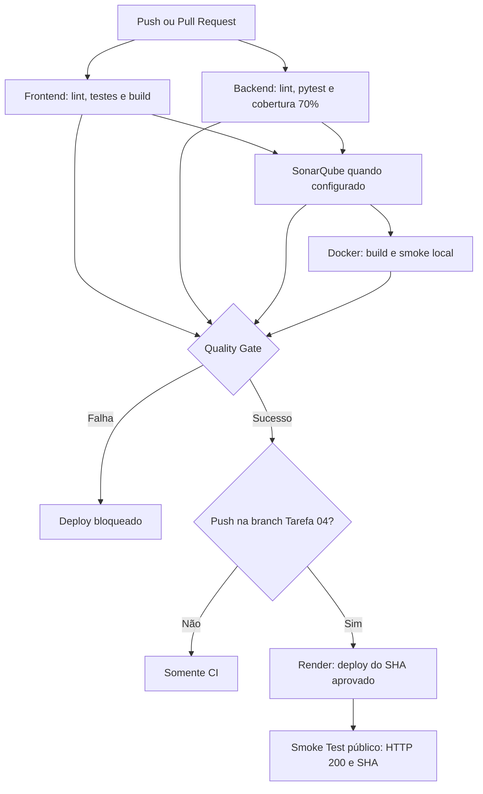

# Tarefa 04 — DevOps, Integração e Entrega Contínua (CI/CD)

## Identificação

- Discente: **[preencher nome completo]**
- GitHub: **[preencher usuário do discente]**
- Projeto: Comercializa (base `feature/us04-tarefa03`, commit `f6eade671d128988bafa9bfee89f39b39deb1773` do ZIP fornecido).
- Branch proposta: `feature/tarefa04-cicd`.
- Repositório indicado no README original: https://github.com/arthurazvd/comercializa (confirmar o fork individual).
- Issue da disciplina: [preencher após criação]
- Pull Request da disciplina: [preencher após criação]
- URL pública: [preencher após publicação]

## 1. Fundamentação teórica

**DevOps:** integração de desenvolvimento e operações por meio de colaboração, automação e feedback. No Comercializa, o GitHub Actions centraliza verificações e publicação, reduzindo etapas manuais.

**Continuous Testing:** execução recorrente de testes ao longo do ciclo de entrega. Os testes Python e JavaScript são executados a cada push ou Pull Request.

**Shift-Left Testing:** antecipação das verificações para antes da publicação. O lint, os testes, a cobertura e o teste do contêiner ocorrem antes do deploy.

**Shift-Right Testing:** verificação da aplicação após a publicação ou em ambiente próximo de produção. O Smoke Test público consulta `/health` após o Render informar que a versão está Live.

**CI (Continuous Integration):** integração frequente de alterações com verificações automatizadas. A pipeline instala dependências, verifica código, executa testes e gera cobertura XML.

**CD (Continuous Delivery/Deployment):** entrega contínua mantém versões prontas para publicação; implantação contínua publica automaticamente as versões aprovadas. A configuração proposta utiliza implantação contínua na branch da atividade, condicionada ao Quality Gate.

**Quality Gate:** critérios objetivos que impedem que alterações reprovadas avancem. O job `quality-gate` exige sucesso de frontend, backend, SonarQube (quando configurado) e Docker. A cobertura mínima existente de 70% foi mantida.

**Docker:** empacota a aplicação e suas dependências em uma imagem. O Dockerfile multi-stage compila Vue com Node 22 e executa Django/Gunicorn com Python 3.12. O PostgreSQL permanece externo em produção.

## 2. Diagnóstico e implementação

O projeto original já incluía pytest, testes Node, cobertura, SonarQube, workflows de mutação e E2E/Playwright, Render/Neon e `/api/health/`. O workflow `tests.yml` foi substituído por `ci.yml` para não duplicar a CI. Os workflows de mutação e P3 foram preservados; são independentes do gate da Tarefa 04.

| Arquivo | Alteração |
| --- | --- |
| `.github/workflows/ci.yml` | CI e CD no mesmo workflow, com dependência explícita entre jobs |
| `Dockerfile`, `.dockerignore` | Imagem integrada, excluindo dependências locais e segredos |
| `backend/docker-entrypoint.sh` | Coleta estáticos, migra banco, inicializa admin em produção e inicia Gunicorn |
| `backend/config/settings.py`, `urls.py` | Distribuição Vue integrada e aliases de saúde |
| `backend/core/auth_views.py` | Cabeçalho de revisão e prevenção de cache no endpoint |
| `backend/tests/test_health_tarefa04.py` | Teste do endpoint público, resposta e revisão |
| `backend/pyproject.toml`, `scripts/lint-frontend.mjs` | Ruff para erros críticos e validação estática JS/Vue |
| `render.yaml` | Serviço Docker separado, sem autodeploy nativo |
| `scripts/deploy_render.py`, `scripts/smoke.py` | Deploy do SHA aprovado, espera por Live e Smoke Test |

## 3. Fluxo CI/CD



A API do Render recebe `commitId`, não simplesmente a última versão da branch. O script aguarda o deploy específico ficar Live, confirma seu SHA e o Smoke Test também exige o cabeçalho `X-Comercializa-Revision` igual ao commit aprovado. Assim, uma resposta 200 de uma versão antiga não é suficiente. O Render deve permanecer com Auto-Deploy Off; publicações manuais fora do fluxo devem ser evitadas. PRs não publicam. O SonarQube é opcional quando não há secrets, mas, quando configurado, seu Quality Gate também é exigido. Os demais controles não são opcionais.

## 4. Smoke Test

O endpoint original `/api/health/` foi preservado e `/health` e `/health/` foram acrescentados. O retorno esperado, sem autenticação, é HTTP 200 e JSON `{"status":"ok"}`. O teste verifica disponibilidade básica, não a integridade de todas as funcionalidades ou do banco.

```bash
python scripts/smoke.py https://URL-DO-SERVICO --revision SHA-APROVADO
```

## 5. Evidências e validação

Resultados realmente obtidos no ambiente local de preparação:

- Frontend: 98 testes aprovados, 0 falhas (`frontend-sucesso.log`).
- Simulação local: 98 aprovados, 1 falha proposital; comando retornou código 1 (`frontend-falha-local.log`). O teste proposital foi removido da entrega final.
- Sintaxe Python, YAML, script JavaScript de lint e shell verificada.
- Backend, build Vue completo, lint com dependências e Docker: não executados localmente por ausência de dependências/daemon e acesso aos registros de pacotes. Devem ser validados no GitHub Actions.

**A demonstração local não comprova que o Render bloqueou uma publicação.** Para concluir essa etapa, reproduzir a falha após obter um primeiro deploy aprovado e anexar as evidências reais a seguir:

| Evidência | Link ou captura a inserir |
| --- | --- |
| CI aprovada, cobertura e Docker | Pendente |
| Primeiro deploy Live (SHA anterior) | Pendente |
| Workflow com teste falhando | Pendente |
| Quality Gate vermelho e CD skipped | Pendente |
| Histórico Render sem deploy do SHA reprovado | Pendente |
| Workflow corrigido e deploy Live | Pendente |
| Smoke Test HTTP 200 e SHA corrigido | Pendente |

A falha pode ser reproduzida com um arquivo temporário em `frontend/tests/quality-gate-demo.test.js`:

```js
import test from 'node:test'
import assert from 'node:assert/strict'
test('falha proposital do Quality Gate', () => assert.equal(1, 2))
```

Enviar o arquivo em um commit, registrar o workflow e o histórico do Render, removê-lo em outro commit e registrar a aprovação, a publicação e a resposta HTTP 200. Não executar deploy manual do commit reprovado.

## 6. Conclusão

A configuração implementa um fluxo automatizado de lint, testes, cobertura, build, validação de contêiner e publicação condicionada ao Quality Gate. A validação local dos testes JavaScript foi concluída; a comprovação remota do bloqueio, a implantação pública e os links da disciplina permanecem pendentes de configuração e execução nas contas autorizadas.

## Referências

- GitHub Actions: https://docs.github.com/actions
- Render — Deploys: https://render.com/docs/deploys
- Render — Blueprint: https://render.com/docs/blueprint-spec
- Render — Trigger Deploy: https://api-docs.render.com/reference/create-deploy
- Docker: https://docs.docker.com/
